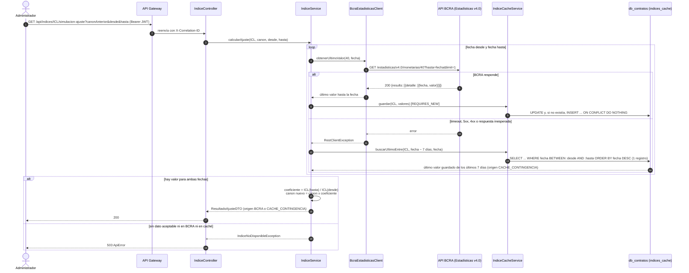
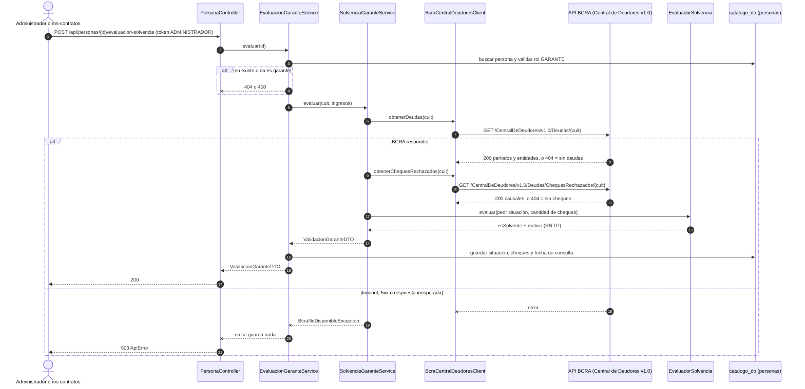

# Integración BCRA y Resiliencia (Dev 4)

Cómo el sistema usa las dos APIs del BCRA, qué hace cuando no responden y por qué. Referencias al [Alcance](./Alcance.md): F-08, F-13, RN-07, RN-11, RN-12 y la sección 14.

## 1. Qué se implementó

### ms-contratos: índices ICL e IPC con caché de contingencia

| Pieza | Clase | Qué hace |
| :--- | :--- | :--- |
| Cliente HTTP | `client/bcra/BcraEstadisticasClient` | `RestClient` contra la API Estadísticas v4.0: `GET /estadisticas/v4.0/monetarias/{idVariable}?desde=&hasta=` (serie) y `?hasta=&limit=1` (último valor hasta una fecha). Lo arma con el `RestClient.Builder` de Spring Boot, con `baseUrl`, timeouts e interceptor de logging (Apunte 18) |
| Índices | `model/TipoIndiceEnum` | `ICL` = variable 40 (diaria), `IPC` = variable 27 (inflación mensual en %) |
| Caché | `model/IndiceCache` + `repository/IndiceCacheRepository` + `service/IndiceCacheService` | Tabla `indices_cache` (`tipo_indice`, `fecha`, `valor`, `fecha_consulta`), única por (`tipo_indice`, `fecha`). Guarda ICL e IPC. El diagrama original la llamaba `IndiceIclCache` / `indices_icl_cache` (ver `Diagramas-EntregaFinal.md`) |
| Resiliencia | `service/IndiceService` | BCRA primero; si falla, caché con límite de antigüedad; si no hay valor aceptable, 503 (RN-12) |
| Cálculo | `service/CalculadoraAjuste` | Coeficiente ICL / IPC, canon nuevo, % de variación |
| API | `controller/IndiceController` | Consultas de solo lectura en `/api/indices/**` (sección 3) |

**Fórmulas**

- ICL (RN-11): `coeficiente = ICL(hasta) / ICL(desde)`.
- IPC: `coeficiente = (1 + v1/100) x (1 + v2/100) x ... x (1 + vN/100)`. Para la ventana (`desde`, `hasta`) se usan las variaciones de los **meses cuyo primer día está en `[desde − 1 mes, hasta − 1 mes)`**: un mes de rezago, porque el IPC del mes M se publica a mediados de M+1. Ejemplos: 01/07 → 01/10 usa junio, julio y agosto; 27/07 → 27/10 usa julio, agosto y septiembre. El resultado depende solo de la ventana, no del día en que se calcula. Si falta alguno de esos meses (todavía no publicado, o el BCRA caído y el caché sin ese mes) → **503** "IPC de agosto 2026 todavía no publicado; el ajuste queda pendiente", y el ajuste programado lo reintenta en la próxima ejecución. Una ventana sin ningún mes (menos de un mes) → 400. El BCRA fecha cada mes en su último día (`2026-08-31`); el servicio los agrupa por mes.
- `Canon nuevo = canon anterior x coeficiente` (redondeo a 2 decimales con `BigDecimal`, Apunte 13).

**Valor del ICL en una fecha (Alcance, sección 14):** con el BCRA arriba, si no hay valor publicado para la fecha exacta se toma el **último publicado anterior a esa fecha**. Al BCRA se le pide `hasta=fecha&limit=1`: según la documentación de la API v4.0, `desde` es opcional (por defecto el inicio de la serie), `limit` indica cuántos registros devolver y la serie viene de la fecha más nueva a la más vieja. La respuesta informa la fecha real del valor (`fechaIndice`) además de la pedida (`fechaSolicitada`).

**Límite de antigüedad del caché (contingencia):** con el BCRA caído, un valor del caché solo se acepta si su fecha está **como mucho 7 días antes** de la pedida (`bcra.cache.max-antiguedad-dias`, default 7). Se busca con un `@Query` entre `fecha − 7 días` y `fecha`, ordenado por fecha descendente, con `PageRequest.of(0, 1)` (Apunte 16). Si no hay → 503 y el ajuste queda pendiente: es preferible postergarlo a aplicar un ajuste parcial con un ICL de hace meses. Para el valor puntual del IPC (`/api/indices/IPC/valor`) se acepta un mes del caché del mes de la fecha o de los 2 anteriores (`bcra.indices.meses-tolerancia-ipc`), que es el rezago normal de publicación.

**Fechas futuras:** se rechazan con 400 (según el `Clock` inyectado, no `LocalDate.now()`). Es una regla nuestra, no de la API: el BCRA **sí** publica el ICL por adelantado (el 17/11/2026 la API ya devuelve valores hasta el 16/12/2026), pero un ajuste solo usa períodos cumplidos (RN-11).

**Transacciones y concurrencia:** `IndiceService` no tiene `@Transactional` y no depende de que lo llamen dentro o fuera de una transacción. `IndiceCacheService.guardar` corre en una transacción propia (`REQUIRES_NEW`):

- lo cacheado queda guardado aunque el ajuste que lo pidió se rechace o se revierta (RN-12: "cada valor obtenido se guarda");
- si guardar falla, se loguea un `warn` y se responde con el dato del BCRA; la transacción de quien llamó **no** queda marcada rollback-only;
- el guardado es idempotente: `UPDATE` del valor y, si no existía, `INSERT ... ON CONFLICT DO NOTHING` con `@Modifying @Query(nativeQuery = true)` (Apunte 16). Dos o tres ajustes que piden la misma fecha a la vez no fallan por la clave única (`tipo_indice`, `fecha`) ni dejan la sesión de Hibernate inconsistente (antes: `duplicate key` y `HHH000099 null id in IndiceCache entry`, con 500). Los valores se escriben siempre ordenados por fecha para que dos transacciones no se bloqueen en cruz.
- Si tampoco se puede leer el caché (base caída), se trata como caché vacío: 503, no 500.

### ms-catalogo: Central de Deudores y solvencia del garante (F-08)

| Pieza | Clase | Qué hace |
| :--- | :--- | :--- |
| Cliente HTTP | `client/bcra/BcraCentralDeudoresClient` | `GET /CentralDeDeudores/v1.0/Deudas/{cuit}` y `/Deudas/ChequesRechazados/{cuit}`. El **404 del BCRA significa "sin registros"**, no error. El CUIT se enmascara en los logs (`*******6789`) |
| Reglas (RN-07) | `service/EvaluadorSolvencia` | Solvente si `situación <= 2` y `cheques rechazados == 0`. Nada más |
| Consulta | `service/SolvenciaGaranteService` | Normaliza el CUIT con `ValidadorCuit.normalizar`, consulta deudas y cheques y arma el `ValidacionGaranteDTO` de commons. Valida la respuesta: una situación fuera de 1..6 es una respuesta inválida del BCRA (503) |
| Endpoint | `service/EvaluacionGaranteService` + `PersonaController` (Dev 2) | `POST /api/personas/{id}/evaluacion-solvencia`: busca la persona, valida el rol GARANTE, evalúa y guarda el resultado en la persona |
| Errores | `exception/BcraNoDisponibleException` | El `CatalogoExceptionHandler` la devuelve como 503 |

Situación crediticia: se toma la **peor** situación entre todas las entidades del **último período** informado (valores válidos: 1 a 6). Cheques: se cuentan todos los informados, de todas las causales y entidades.

**Datos personales en logs:** el CUIT nunca se loguea completo, solo los últimos 4 dígitos. Cuando el BCRA falla se loguea el **tipo** de error (y el status HTTP si lo hay), no `ex.getMessage()`: el mensaje de `ResourceAccessException` trae la URL `.../Deudas/{cuit}` completa (Apunte 18: no loguear datos sensibles).

## 2. Estrategia de resiliencia (para la defensa)

El enunciado pide explicar "qué sucede cuando el servicio externo no se encuentra disponible o devuelve una respuesta inesperada":

| Situación | ICL / IPC (contratos) | Central de Deudores (catálogo) |
| :--- | :--- | :--- |
| BCRA responde bien | Usa el valor y lo **guarda en `indices_cache`** (transacción propia, upsert idempotente) | Evalúa y guarda el resultado en la persona |
| Timeout (contratos 3 s conexión / 5 s lectura; catálogo 2 s / 3 s) | `log.warn` + usa el caché | 503 |
| BCRA caído / 5xx | `log.warn` + usa el caché | 503 |
| 429 (cuota agotada), 401 o 403 del BCRA | `log.warn` + usa el caché | 503 |
| 400 o 404 del BCRA | **`log.error` con el status** + usa el caché. El tipo de índice es un enum, así que solo pasa por configuración (`bcra.api.base-url`) o un cambio de versión de la API (riesgo de la sección 13): es una falla de integración, no del pedido | 404 = "sin registros"; 400 → 503 |
| JSON sin la estructura esperada | Se trata igual que una caída | 503 |
| Situación fuera de 1..6 | n/a | Respuesta inválida: 503 (no se califica al garante) |
| Caché con un valor de hasta 7 días antes de la fecha pedida | Se usa (`origen: CACHE_CONTINGENCIA`) | n/a |
| Caché sin valor, con uno de más de 7 días antes, o ilegible | **503**: el ajuste queda pendiente (RN-12) | n/a |
| IPC de un mes de la ventana todavía no publicado (BCRA arriba) | **503** "IPC de <mes> todavía no publicado; el ajuste queda pendiente" | n/a |
| Pedido inválido: fecha futura, fechas invertidas, ventana de IPC sin meses, o fecha anterior al inicio de la serie (ICL antes del 01/07/2020: el BCRA responde sin valores) | **400**: no se usa el caché | n/a |
| Falla al guardar en el caché | `log.warn` y se responde igual con el dato del BCRA; la transacción de quien llamó sigue sana | n/a |
| 404 en Central de Deudores | n/a | "Sin registros": situación 1, 0 cheques |

- La respuesta de índices siempre informa `origen: BCRA` o `origen: CACHE_CONTINGENCIA`, para auditar con qué dato se calculó cada ajuste.
- La Central de Deudores no tiene caché: si el BCRA no responde, no se califica al garante como solvente (RN-07). Nunca se asume un resultado favorable.

Base en los apuntes: Apunte 18 (RestClient, manejo de errores HTTP, timeouts, logging de llamadas salientes, no loguear datos sensibles), Apunte 19 (caché), Apunte 16 (`@Query` con parámetros nombrados, `Pageable`, `@Transactional`), Apunte 17 (capas, `ResponseEntity`, Swagger) y Apunte 07 (JUnit).

## 3. Endpoints

ms-contratos (8082, por el Gateway en `/api/indices/**`; solo lectura, cualquier rol autenticado):

```
GET /api/indices/{ICL|IPC}/valor?fecha=2026-10-26
GET /api/indices/{ICL|IPC}/coeficiente?desde=2026-07-27&hasta=2026-10-27
GET /api/indices/{ICL|IPC}/simulacion-ajuste?canonAnterior=500000&desde=2026-07-27&hasta=2026-10-27
```

ms-catalogo (8081, por el Gateway en `/api/personas/**`; solo ADMINISTRADOR):

```
POST /api/personas/{id}/evaluacion-solvencia
```

Errores: 400 (tipo, fecha o parámetro inválido; persona que no es garante), 404 (persona inexistente) y 503 (BCRA no disponible), siempre con el `ApiError` de commons y su `correlationId`.

Configuración (opcional, con estos valores por defecto en el código):

| Propiedad | Servicio | Default |
| :--- | :--- | :--- |
| `bcra.api.base-url` | ambos | `https://api.bcra.gob.ar` |
| `bcra.api.connect-timeout-ms` / `read-timeout-ms` | contratos | 3000 / 5000 |
| `bcra.api.connect-timeout-ms` / `read-timeout-ms` | catálogo | 2000 / 3000 |
| `bcra.cache.max-antiguedad-dias` | contratos | 7 (antigüedad máxima de un valor del caché en contingencia) |
| `bcra.indices.meses-tolerancia-ipc` | contratos | 2 (solo para el valor puntual del IPC en contingencia: meses anteriores aceptados del caché) |
| `bcra.solvencia.situacion-maxima` | catálogo | 2 |
| `bcra.solvencia.cheques-rechazados-maximos` | catálogo | 0 |

Ejemplo real (27/10/2026, canon $500.000, trimestre 27/07 al 27/10):

| Índice | Coeficiente | Canon nuevo |
| :--- | :--- | :--- |
| ICL (34,93 a 37,11) | 1,06241054 (+6,24 %) | $531.205,27 |
| IPC (jul 2,1 % · ago 1,7 % · sep 1,9 %: meses que empiezan en [27/06, 27/09)) | 1,05808578 (+5,81 %) | $529.042,89 |

## 4. Por qué agregamos el IPC

El alcance comprometido es el ajuste por ICL (F-13, RN-11, RN-12, C-05) y se evalúa así. El IPC se agregó como **funcionalidad adicional**:

- **Motivo:** desde la derogación de la Ley de Alquileres (DNU 70/2023) el índice de actualización se pacta libremente, y en los contratos nuevos se usa mucho el IPC. Con solo el ICL el sistema no cubría esos contratos.
- **Costo:** casi ninguno. Usa la misma API del BCRA (otra variable), el mismo caché de contingencia y la misma fórmula de canon. No agrega servicios ni dependencias. `Contrato` y `Ajuste` ya guardan `tipo_indice`, con ICL por defecto.
- **Qué cambia para el usuario:** al crear el contrato se puede indicar `"tipoIndice": "IPC"` (si no se indica, queda ICL), y el ajuste usa el índice pactado. Las consultas de `/api/indices` permiten ver cualquiera de los dos y simular un ajuste antes de aplicarlo.

## 5. Perfil `demo` (BCRA simulado)

El repo no puede usar CUITs de personas reales (Alcance, sección 12). Con el perfil `demo`, cada microservicio reemplaza su cliente del BCRA por una subclase simulada (`@Primary @Profile("demo")`), sin tocar la lógica real:

| Clase | Qué simula |
| :--- | :--- |
| `BcraCentralDeudoresClientSimulado` (catálogo) | `20888888811` situación 3 · `20888888838` 2 cheques rechazados · `20888888846` situación 2 · cualquier otro CUIT sin registros (solvente). DNIs de un rango no asignado |
| `BcraEstadisticasClientSimulado` (contratos) | ICL 10,00 antes del 01/08/2026 y 12,50 desde esa fecha (C-05: +25 %), también para fechas futuras como la API real · IPC 2 % mensual, fechado el último día del mes y publicado el **día 15 del mes siguiente** según el `Clock` de la aplicación (agosto 2026 aparece desde el 15/09/2026). El ajuste IPC 01/07/2026 → 01/10/2026 usa junio, julio y agosto: 1,02³ = +6,12 %, canon 530.604 |
| `GeoRefClientSimulado` (catálogo) | GeoRef real, salvo con la caída simulada prendida |

Las caídas se prenden y apagan con `PUT /api/demo/catalogo/simulacion?bcraCaido=&georefCaido=` y `PUT /api/demo/contratos/simulacion?bcraCaido=` (solo ADMINISTRADOR; fuera del perfil `demo` esos endpoints no existen). La caída simulada lanza `ResourceAccessException`, igual que un timeout real, así que se recorre el mismo camino de resiliencia de la sección 2.

Cómo levantarlo: ver el README (sección "Perfil demo y Colección Postman").

## 6. Tests

JUnit 5 + Mockito + `MockRestServiceServer`:

- ms-contratos: `CalculadoraAjusteTest` (5), `IndiceServiceTest` (27, con `Clock` fijo: fallback al caché, límite de 7 días, último publicado anterior con el BCRA arriba, 503 sin caché o con caché ilegible, 429, 403, 400 y 404 del BCRA, fecha futura, falla al guardar el caché, ICL, meses del IPC, IPC anclado a la ventana, IPC no publicado → 503, IPC desde el caché y el caso C-05), `IndiceCacheRepositoryTest` (4, `@DataJpaTest` con H2 en modo PostgreSQL: `INSERT ... ON CONFLICT DO NOTHING`, update, límite de antigüedad), `IndiceCacheServiceTest` (4, base real y `TransactionTemplate`: el caché sobrevive al rollback del ajuste, una falla al guardar no deja la transacción rollback-only, tres guardados concurrentes de la misma fecha), `BcraEstadisticasClientTest` (5), `BcraEstadisticasClientSimuladoTest` (5) y en `ContratoServiceTest` el ajuste por IPC y el índice por defecto.
- ms-catalogo: `EvaluadorSolvenciaTest` (6), `SolvenciaGaranteServiceTest` (13: BCRA caído, CUIT enmascarado en el log, situación fuera de 1..6, normalización con `ValidadorCuit`), `BcraCentralDeudoresClientTest` (3, incluye el 404 = sin registros), `BcraCentralDeudoresClientSimuladoTest` (2) y `EvaluacionGaranteServiceTest` (7, de Dev 2).

Colección Postman: `coleccion/RovedaSA.postman_collection.json` + `coleccion/local.postman_environment.json` (98 requests, carpetas 00 a 06 de la sección 12 del Alcance; requiere el perfil `demo` y bases limpias).

## 7. Diagramas de secuencia

### Ajuste de canon por ICL con caché de contingencia (F-13, RN-11, RN-12)



Con IPC el flujo es el mismo con la variable 27: se piden en una sola consulta los meses de `[desde − 1 mes, hasta − 1 mes)` (`desde` = primer día del primer mes, `hasta` = la fecha del ajuste) y el coeficiente es el producto de (1 + v / 100). Si falta un mes, 503 y el ajuste queda pendiente.

### Evaluación del garante en la Central de Deudores (F-08, la usa F-11 al activar)


