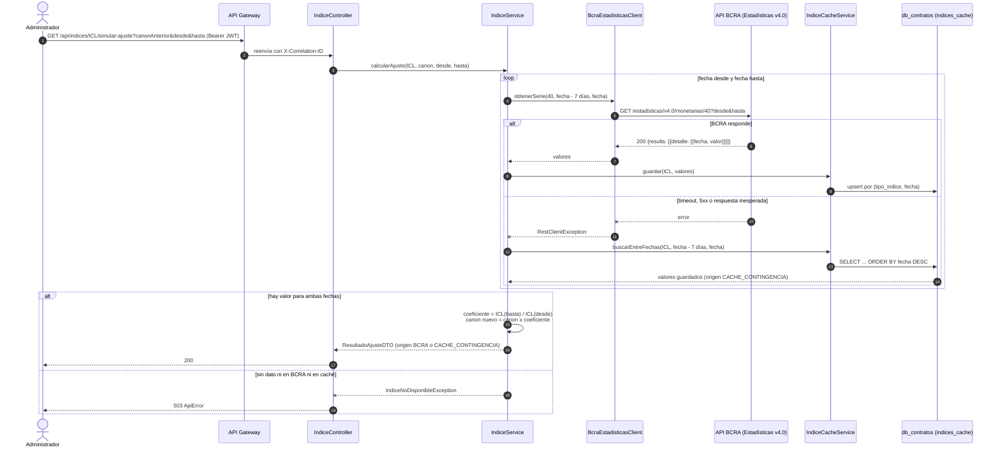
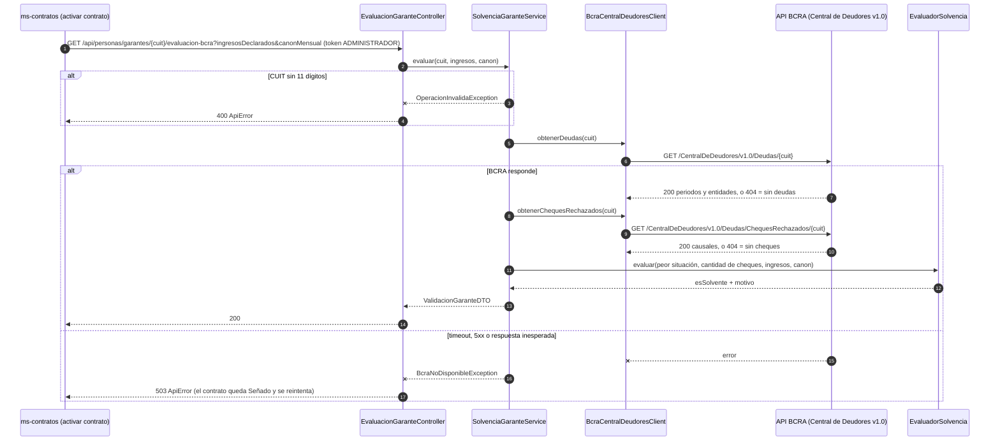

# Integración BCRA y Resiliencia (Dev 4)

Qué hay en la rama `feature/bcra-resiliencia`, cómo se usa y qué falta conectar con el trabajo de cada uno. Sale de `develop` y **no depende de ninguna otra rama**: se puede mergear antes o después de catálogo y contratos. Usa la misma convención de paquetes en singular que catálogo (`controller`, `service`, `model`, `dto`, `repository`, `exception`). No modifica ningún `application.yml`: toda la configuración tiene valores por defecto en el código (sección 3).

## 1. Qué se implementó

### ms-contratos: índices ICL e IPC con caché de contingencia

| Pieza | Clase | Qué hace |
| :--- | :--- | :--- |
| Cliente HTTP | `client/bcra/BcraEstadisticasClient` | `RestClient` contra `GET /estadisticas/v4.0/monetarias/{idVariable}?desde=&hasta=`. Lo arma con el `RestClient.Builder` de Spring Boot, con `baseUrl`, timeouts e interceptor de logging (Apunte 18). No publica un bean `RestClient`, así no choca con los clientes que agreguen otros |
| Índices | `model/TipoIndiceEnum` | `ICL` = variable 40 (diaria), `IPC` = variable 27 (inflación mensual en %) |
| Caché | `model/IndiceCache` + `repository/IndiceCacheRepository` | Tabla `indices_cache` (tipo, fecha, valor, fechaConsulta). Generaliza `IndiceIclCache` del diagrama para guardar ICL e IPC |
| Resiliencia | `service/IndiceService` | BCRA primero; si falla, caché; si no hay caché, 503 |
| Cálculo | `service/CalculadoraAjuste` | Coeficiente ICL / IPC, canon nuevo, % de variación |
| API | `controller/IndiceController` | Endpoints `/api/indices/**` (ver sección 3) |

**Fórmulas**

- ICL: `coeficiente = ICL(hasta) / ICL(desde)`
- IPC: `coeficiente = (1 + v1/100) x (1 + v2/100) x ... x (1 + vN/100)`. Se usan los **últimos N meses publicados** al momento del ajuste, con N = meses entre `desde` y `hasta` (trimestral = 3). El IPC se publica con atraso, por eso no se puede exigir el mes exacto del ajuste.
- `Canon Nuevo = Canon Anterior x coeficiente` (redondeo a 2 decimales, `BigDecimal`, Apunte 13)

### ms-catalogo: Central de Deudores y solvencia del garante (CU-02)

| Pieza | Clase | Qué hace |
| :--- | :--- | :--- |
| Cliente HTTP | `client/bcra/BcraCentralDeudoresClient` | `GET /CentralDeDeudores/v1.0/Deudas/{cuit}` y `/Deudas/ChequesRechazados/{cuit}`. El **404 del BCRA significa "sin registros"**, no error. Arma su `RestClient` igual que `GeoRefClient` de catálogo |
| Reglas | `service/EvaluadorSolvencia` | `situacion <= 2`, `cheques == 0`, `ingresos >= 3 x canon` (configurable) |
| Servicio | `service/SolvenciaGaranteService` | Consulta deudas y cheques por CUIT y arma el `ValidacionGaranteDTO` de commons |
| Errores | `exception/BcraNoDisponibleException` + `exception/BcraExceptionHandler` | 503 si el BCRA no responde; el handler está acotado a este controller |
| API | `controller/EvaluacionGaranteController` | `GET /api/personas/garantes/{cuit}/evaluacion-bcra?ingresosDeclarados=&canonMensual=` (solo ADMINISTRADOR, `@PreAuthorize`) |

Situación crediticia: se toma la **peor** situación entre todas las entidades del **último período** informado.

## 2. Estrategia de resiliencia (para la defensa)

El enunciado pide explicar "qué sucede cuando el servicio externo no se encuentra disponible o devuelve una respuesta inesperada". Ese es el comportamiento:

| Situación | ICL / IPC (contratos) | Central de Deudores (catálogo) |
| :--- | :--- | :--- |
| BCRA responde bien | Usa el valor y lo **guarda en `indices_cache`** | Evalúa |
| Timeout (3 s conexión / 5 s lectura) | `log.warn` + usa el caché | `log.warn` + 503 |
| BCRA caído / 5xx | `log.warn` + usa el caché | Igual que timeout |
| 429 (cuota agotada), 401 o 403 del BCRA | `log.warn` + usa el caché | Igual que timeout |
| JSON sin la estructura esperada | Se trata igual que una caída | Igual que timeout |
| Pedido inválido: fecha futura, 400 o 404 del BCRA, o el BCRA responde pero no tiene valores en ese rango | **400**: no es una caída, no se usa el caché | 400 (CUIT mal formado) |
| Falla al guardar en el caché | Se registra un `log.warn` y se responde igual con el dato del BCRA | n/a |
| Sin dato en el caché | **503**: no se aplica un ajuste con datos viejos o inventados | n/a |
| 404 en Central de Deudores | n/a | "Sin registros": situación 1, 0 cheques |

- La respuesta siempre informa `origen: BCRA` o `origen: CACHE_CONTINGENCIA`, para auditar con qué dato se calculó cada ajuste.
- Tolerancias configurables (sección 3): el ICL de contingencia puede tener hasta 7 días de antigüedad y el IPC hasta 2 meses de atraso.
- Central de Deudores responde 503 si el BCRA no está: no se afirma que alguien es solvente sin datos. Cuando se integre con la `Persona` de catálogo, la última consulta se guarda ahí y se usa como contingencia (sección 5).

Base en los apuntes: Apunte 18 (RestClient, `RestClientResponseException`, timeouts, fallback, logging de llamadas salientes, no loguear datos sensibles: el CUIT se enmascara), Apunte 19 (concepto de caché), Apunte 16 (`@Query`, `@Transactional`), Apunte 17 (capas, `ResponseEntity`, `@RestControllerAdvice`, Swagger), Apunte 07 (JUnit).

## 3. Endpoints

ms-contratos (puerto 8082):

```
GET /api/indices/{ICL|IPC}/valor?fecha=2026-10-26
GET /api/indices/{ICL|IPC}/coeficiente?desde=2026-07-27&hasta=2026-10-27
GET /api/indices/{ICL|IPC}/simular-ajuste?canonAnterior=500000&desde=2026-07-27&hasta=2026-10-27
```

ms-catalogo (puerto 8081, ya enrutado por el Gateway bajo `/api/personas/**`):

```
GET /api/personas/garantes/{cuit}/evaluacion-bcra?ingresosDeclarados=1500000&canonMensual=400000
```

Errores: 400 (tipo/fecha/CUIT inválido o parámetro faltante) y 503 (BCRA no disponible), siempre con el `ApiError` de commons y su `correlationId`.

Configuración (todas opcionales, con estos valores por defecto en el código):

| Propiedad | Servicio | Default |
| :--- | :--- | :--- |
| `bcra.api.base-url` | ambos | `https://api.bcra.gob.ar` |
| `bcra.api.connect-timeout-ms` / `read-timeout-ms` | ambos | 3000 / 5000 |
| `bcra.indices.dias-tolerancia-icl` | contratos | 7 |
| `bcra.indices.meses-tolerancia-ipc` | contratos | 2 |
| `bcra.solvencia.situacion-maxima` | catálogo | 2 |
| `bcra.solvencia.cheques-rechazados-maximos` | catálogo | 0 |
| `bcra.solvencia.multiplo-ingresos-canon` | catálogo | 3 (a confirmar con el equipo) |

Swagger: `/swagger-ui.html` en cada servicio (`springdoc-openapi-starter-webmvc-ui` 2.6.0; la 2.3.0 del apunte es para Boot 3.2 y el proyecto usa Boot 3.3.4). La dependencia se agregó a los dos `pom.xml` con exactamente las mismas líneas que usa la rama de catálogo, así el merge no da conflicto.

Ejemplo real (27/10/2026, canon $500.000, trimestre 27/07 al 27/10):

| Índice | Coeficiente | Canon nuevo |
| :--- | :--- | :--- |
| ICL (34,93 a 37,11) | 1,06241054 (+6,24 %) | $531.205,27 |
| IPC (jul 2,1 % · ago 1,7 % · sep 1,9 %) | 1,05808578 (+5,81 %) | $529.042,89 |

## 4. Qué tiene que conectar cada uno

**Dev 3 (Contratos):**
- Agregar `tipoIndice` (`TipoIndiceEnum`, `@Enumerated(EnumType.STRING)`) a `Contrato`, así cada contrato elige ICL o IPC.
- En `Activo.aplicarAjuste(...)` inyectar `IndiceService` y llamar `calcularAjuste(contrato.getTipoIndice(), contrato.getMontoActual(), fechaUltimoAjuste, fechaAjuste)`. El `ResultadoAjusteDTO` trae los mismos campos que la entidad `Ajuste`.
- Para activar un contrato: pedirle a catálogo la evaluación del garante y revisar `esSolvente` del `ValidacionGaranteDTO`. Si catálogo responde 503, el contrato queda `Señado` (se reintenta), no se cancela.

**Dev 2 (Catálogo):** nada. No se tocó ningún archivo suyo. Se probó el merge de esta rama con `feature/catalogo-inmuebles`: sin conflictos y con todos los tests en verde.

**Dev 1 (Gateway / infraestructura):**
- Agregar la ruta `/api/indices/**` hacia ms-contratos en `GWConfig`.
- Agregar `<parameters>true</parameters>` al `maven-compiler-plugin` del POM padre. Sin eso, Spring 6.1 no conoce los nombres de los parámetros y fallan `@PathVariable` / `@RequestParam` / `@Query` si no se escribe el nombre explícito (en este código se escribió siempre el nombre).
- El `spring-boot-maven-plugin` está solo en `pluginManagement` sin el goal `repackage`: `mvn package` genera un jar que **no se puede ejecutar** con `java -jar` ("no main manifest attribute"). Hace falta para las imágenes Docker.
- Opcional: sumar al `GlobalExceptionHandler` de commons los casos 503, `MethodArgumentTypeMismatchException` y `MissingServletRequestParameterException`. Hoy terminan en 500; por eso los endpoints de Dev 4 tienen su propio advice acotado a sus controllers.

## 5. Pendiente de Dev 4

- **Proceso masivo de indexación** (CU-04): endpoint `POST` que recorra los contratos `ACTIVO` con `mesesTranscurridos >= frecuenciaAjusteMeses`, llame a `IndiceService.calcularAjuste` y registre el `Ajuste`. Depende de que existan `Contrato`, `Ajuste` y su repositorio (Dev 3). Se hace como endpoint y no con scheduler porque el scheduler no está en los apuntes.
- **Integración con `Persona`** (después del merge con catálogo): evaluar por id de persona en vez de por CUIT, guardar la consulta en `situacionCrediticiaBcra`, `chequesRechazados` y `fechaConsultaBcra` y usarla como contingencia si el BCRA se cae (hasta 30 días). En ese paso se reemplaza `BcraNoDisponibleException` por la `ServicioExternoNoDisponibleException` de catálogo y la validación del CUIT por su `ValidadorCuit` (módulo 11).
- Completar la colección de Postman con el tramo de contratos cuando exista.

## 6. Tests

`mvn clean verify` corre 22 tests en contratos y 14 en catálogo (JUnit 5 + Mockito + `MockRestServiceServer`):

- `CalculadoraAjusteTest`, `IndiceServiceTest` (fallback al caché, 503 sin caché, 429, 403, 400, fecha futura, falla al guardar el caché, ICL, IPC encadenado), `BcraEstadisticasClientTest`
- `EvaluadorSolvenciaTest`, `SolvenciaGaranteServiceTest` (incluye BCRA caído), `BcraCentralDeudoresClientTest` (incluye el 404 = sin registros)

Colección Postman: `postman/TPI-RovedaSA.postman_collection.json` + entorno `postman/TPI-RovedaSA-local.postman_environment.json`. Cubre el flujo de catálogo + BCRA de punta a punta, índices, seguridad y errores. Los pasos de personas y propiedades usan los endpoints de la rama de catálogo: se ejecutan completos una vez mergeada.

## 7. Diagramas de secuencia

### Ajuste de canon por ICL o IPC con caché de contingencia (CU-04)



Con IPC el flujo es el mismo con la variable 27 (inflación mensual): se piden los últimos N meses publicados en una sola consulta y el coeficiente es el producto de (1 + v / 100).

### Evaluación del garante en la Central de Deudores (CU-02, la usa CU-03 al activar)


