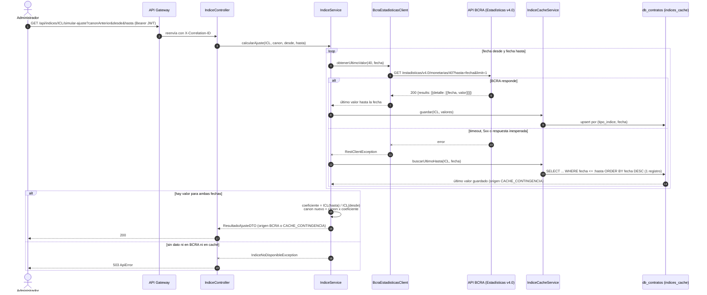
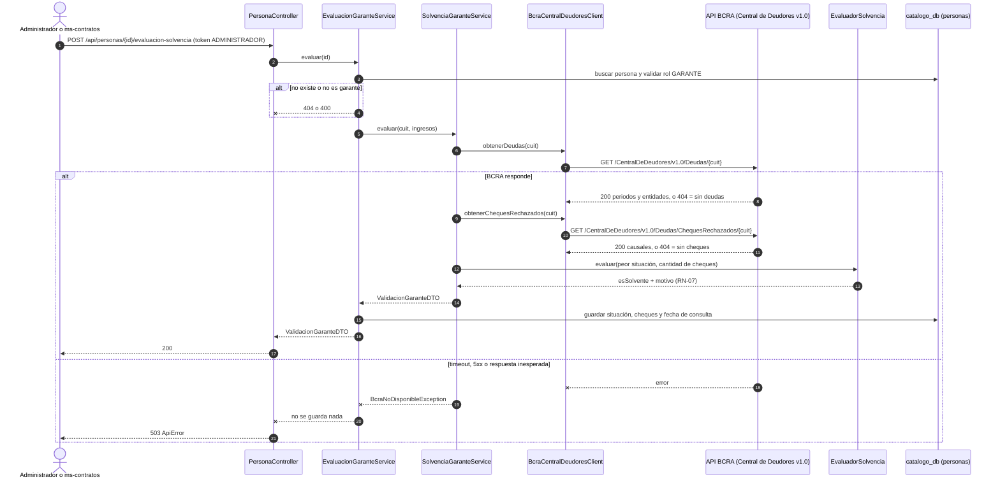

# Integración BCRA y Resiliencia (Dev 4)

Cómo el sistema usa las dos APIs del BCRA, qué hace cuando no responden y por qué. Referencias al [Alcance](./Alcance.md): F-08, F-13, RN-07, RN-11, RN-12 y la sección 14.

## 1. Qué se implementó

### ms-contratos: índices ICL e IPC con caché de contingencia

| Pieza | Clase | Qué hace |
| :--- | :--- | :--- |
| Cliente HTTP | `client/bcra/BcraEstadisticasClient` | `RestClient` contra la API Estadísticas v4.0: `GET /estadisticas/v4.0/monetarias/{idVariable}?desde=&hasta=` (serie) y `?hasta=&limit=1` (último valor hasta una fecha). Lo arma con el `RestClient.Builder` de Spring Boot, con `baseUrl`, timeouts e interceptor de logging (Apunte 18) |
| Índices | `model/TipoIndiceEnum` | `ICL` = variable 40 (diaria), `IPC` = variable 27 (inflación mensual en %) |
| Caché | `model/IndiceCache` + `repository/IndiceCacheRepository` | Tabla `indices_cache` (tipo, fecha, valor, fechaConsulta), única por tipo y fecha. Guarda ICL e IPC |
| Resiliencia | `service/IndiceService` | BCRA primero; si falla, caché; si no hay caché, 503 (RN-12) |
| Cálculo | `service/CalculadoraAjuste` | Coeficiente ICL / IPC, canon nuevo, % de variación |
| API | `controller/IndiceController` | Consultas de solo lectura en `/api/indices/**` (sección 3) |

**Fórmulas**

- ICL (RN-11): `coeficiente = ICL(hasta) / ICL(desde)`.
- IPC: `coeficiente = (1 + v1/100) x (1 + v2/100) x ... x (1 + vN/100)`. Se usan los **últimos N meses publicados** hasta la fecha `hasta`, con N = meses entre `desde` y `hasta` (trimestral = 3). El IPC se publica con atraso, por eso no se puede exigir el mes exacto del ajuste.
- `Canon nuevo = canon anterior x coeficiente` (redondeo a 2 decimales con `BigDecimal`, Apunte 13).

**Valor del ICL en una fecha (Alcance, sección 14):** si no hay valor publicado para la fecha exacta, se toma el **último publicado anterior a esa fecha, sin límite hacia atrás**. Al BCRA se le pide `hasta=fecha&limit=1`: según la documentación de la API v4.0, `desde` es opcional (por defecto el inicio de la serie), `limit` indica cuántos registros devolver y la serie viene de la fecha más nueva a la más vieja. En el caché se hace lo mismo con un `@Query` ordenado por fecha descendente y `PageRequest.of(0, 1)` (Apunte 16). La respuesta informa la fecha real del valor (`fechaIndice`) además de la pedida (`fechaSolicitada`).

### ms-catalogo: Central de Deudores y solvencia del garante (F-08)

| Pieza | Clase | Qué hace |
| :--- | :--- | :--- |
| Cliente HTTP | `client/bcra/BcraCentralDeudoresClient` | `GET /CentralDeDeudores/v1.0/Deudas/{cuit}` y `/Deudas/ChequesRechazados/{cuit}`. El **404 del BCRA significa "sin registros"**, no error. El CUIT se enmascara en los logs |
| Reglas (RN-07) | `service/EvaluadorSolvencia` | Solvente si `situación <= 2` y `cheques rechazados == 0`. Nada más |
| Consulta | `service/SolvenciaGaranteService` | Consulta deudas y cheques por CUIT y arma el `ValidacionGaranteDTO` de commons |
| Endpoint | `service/EvaluacionGaranteService` + `PersonaController` (Dev 2) | `POST /api/personas/{id}/evaluacion-solvencia`: busca la persona, valida el rol GARANTE, evalúa y guarda el resultado en la persona |
| Errores | `exception/BcraNoDisponibleException` | El `CatalogoExceptionHandler` la devuelve como 503 |

Situación crediticia: se toma la **peor** situación entre todas las entidades del **último período** informado. Cheques: se cuentan todos los informados, de todas las causales y entidades.

## 2. Estrategia de resiliencia (para la defensa)

El enunciado pide explicar "qué sucede cuando el servicio externo no se encuentra disponible o devuelve una respuesta inesperada":

| Situación | ICL / IPC (contratos) | Central de Deudores (catálogo) |
| :--- | :--- | :--- |
| BCRA responde bien | Usa el valor y lo **guarda en `indices_cache`** | Evalúa y guarda el resultado en la persona |
| Timeout (3 s conexión / 5 s lectura) | `log.warn` + usa el caché | 503 |
| BCRA caído / 5xx | `log.warn` + usa el caché | 503 |
| 429 (cuota agotada), 401 o 403 del BCRA | `log.warn` + usa el caché | 503 |
| JSON sin la estructura esperada | Se trata igual que una caída | 503 |
| Pedido inválido: fecha futura, 400 o 404 del BCRA, o el BCRA responde pero no tiene valores hasta esa fecha | **400**: no es una caída, no se usa el caché | n/a |
| Falla al guardar en el caché | `log.warn` y se responde igual con el dato del BCRA | n/a |
| Sin dato en el caché | **503**: el ajuste queda pendiente (RN-12) | n/a |
| 404 en Central de Deudores | n/a | "Sin registros": situación 1, 0 cheques |

- La respuesta de índices siempre informa `origen: BCRA` o `origen: CACHE_CONTINGENCIA`, para auditar con qué dato se calculó cada ajuste.
- La Central de Deudores no tiene caché: si el BCRA no responde, no se califica al garante como solvente (RN-07). Nunca se asume un resultado favorable.

Base en los apuntes: Apunte 18 (RestClient, manejo de errores HTTP, timeouts, logging de llamadas salientes, no loguear datos sensibles), Apunte 19 (caché), Apunte 16 (`@Query` con parámetros nombrados, `Pageable`, `@Transactional`), Apunte 17 (capas, `ResponseEntity`, Swagger) y Apunte 07 (JUnit).

## 3. Endpoints

ms-contratos (8082, por el Gateway en `/api/indices/**`; solo lectura, cualquier rol autenticado):

```
GET /api/indices/{ICL|IPC}/valor?fecha=2026-10-26
GET /api/indices/{ICL|IPC}/coeficiente?desde=2026-07-27&hasta=2026-10-27
GET /api/indices/{ICL|IPC}/simular-ajuste?canonAnterior=500000&desde=2026-07-27&hasta=2026-10-27
```

ms-catalogo (8081, por el Gateway en `/api/personas/**`; solo ADMINISTRADOR):

```
POST /api/personas/{id}/evaluacion-solvencia
```

Errores: 400 (tipo, fecha o parámetro inválido; persona que no es garante), 404 (persona inexistente) y 503 (BCRA no disponible), siempre con el `ApiError` de commons y su `correlationId`.

Configuración (opcional, con estos valores por defecto en el código):

| Propiedad | Servicio | Default |
| :--- | :--- | :--- |
| `bcra.api.base-url` | ambos | `https://api.bcra.gob.ar` |
| `bcra.api.connect-timeout-ms` / `read-timeout-ms` | ambos | 3000 / 5000 |
| `bcra.indices.meses-tolerancia-ipc` | contratos | 2 (meses de atraso aceptados en la publicación del IPC) |
| `bcra.solvencia.situacion-maxima` | catálogo | 2 |
| `bcra.solvencia.cheques-rechazados-maximos` | catálogo | 0 |

Ejemplo real (27/10/2026, canon $500.000, trimestre 27/07 al 27/10):

| Índice | Coeficiente | Canon nuevo |
| :--- | :--- | :--- |
| ICL (34,93 a 37,11) | 1,06241054 (+6,24 %) | $531.205,27 |
| IPC (jul 2,1 % · ago 1,7 % · sep 1,9 %) | 1,05808578 (+5,81 %) | $529.042,89 |

## 4. Por qué agregamos el IPC

El alcance comprometido es el ajuste por ICL (F-13, RN-11, RN-12, C-05) y se evalúa así. El IPC se agregó como **funcionalidad adicional**:

- **Motivo:** desde la derogación de la Ley de Alquileres (DNU 70/2023) el índice de actualización se pacta libremente, y en los contratos nuevos se usa mucho el IPC. Con solo el ICL el sistema no cubría esos contratos.
- **Costo:** casi ninguno. Usa la misma API del BCRA (otra variable), el mismo caché de contingencia y la misma fórmula de canon. No agrega servicios ni dependencias. `Contrato` y `Ajuste` ya guardan `tipo_indice`, con ICL por defecto.
- **Qué cambia para el usuario:** el contrato puede pactar ICL o IPC, y las consultas de `/api/indices` permiten ver cualquiera de los dos y simular un ajuste antes de aplicarlo.

## 5. Pendiente de Dev 4

- Perfil `demo` con el BCRA simulado (CUIT solvente, CUIT no solvente, ICL fijo y simulación de caída), para C-04 y C-05.
- Colección Postman en `/coleccion` con las carpetas de la sección 12 del Alcance. El tramo de contratos depende de que exista su API.

## 6. Tests

JUnit 5 + Mockito + `MockRestServiceServer`:

- ms-contratos: `CalculadoraAjusteTest` (5), `IndiceServiceTest` (17: fallback al caché, último valor anterior sin límite, 503 sin caché, 429, 403, 400, fecha futura, falla al guardar el caché, ICL, IPC encadenado y el caso C-05) y `BcraEstadisticasClientTest` (5).
- ms-catalogo: `EvaluadorSolvenciaTest` (6), `SolvenciaGaranteServiceTest` (5, incluye BCRA caído), `BcraCentralDeudoresClientTest` (3, incluye el 404 = sin registros) y `EvaluacionGaranteServiceTest` (7, de Dev 2).

Colección Postman: `postman/TPI-RovedaSA.postman_collection.json` + `postman/TPI-RovedaSA-local.postman_environment.json`.

## 7. Diagramas de secuencia

### Ajuste de canon por ICL con caché de contingencia (F-13, RN-11, RN-12)



Con IPC el flujo es el mismo con la variable 27: se piden los últimos meses publicados en una sola consulta (`desde` y `hasta`) y el coeficiente es el producto de (1 + v / 100).

### Evaluación del garante en la Central de Deudores (F-08, la usa F-11 al activar)


