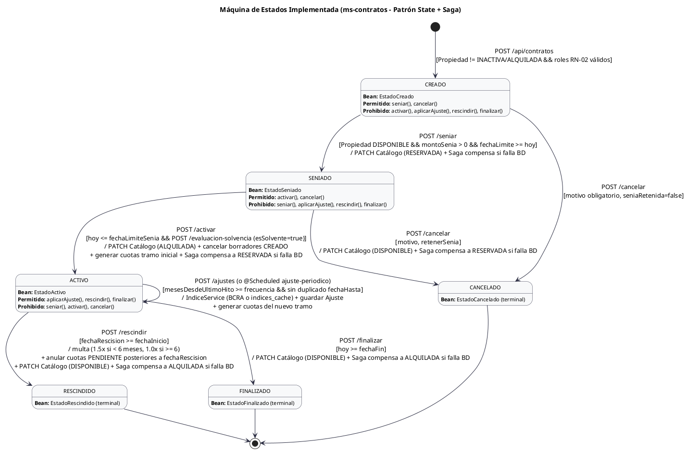

# Diagramas Actualizados — Entrega Final (Alquileres Roveda SA)

> [!NOTE] Comparación con la 1ra Entrega
> Este documento refleja **la arquitectura y el modelo efectivamente implementados** para la presentación final (al 16/11/2026).  
> Los diagramas originales presentados en la 1ra Entrega se mantienen intactos en [Diagramas.md](./Diagramas.md) (y sus imágenes en [`./img/`](./img/)) para conservar la trazabilidad histórica y poder comparar la evolución del diseño.

**Documentos relacionados:** [Diagramas originales (1ra Entrega)](./Diagramas.md) · [Alcance Comprometido](./Alcance.md) · [BCRA y Resiliencia](./BCRA-Resiliencia.md) · [Proceso Principal](./ProcesoPrincipal.md)

---

## 0. Comparación: 1ra Entrega vs. Entrega Final (Qué evolucionó y por qué)

| Aspecto | Diseño 1ra Entrega (`Diagramas.md`) | Implementación Entrega Final (`Diagramas-EntregaFinal.md`) | Justificación / Valor aportado |
| :--- | :--- | :--- | :--- |
| **Rutas y capacidades del API Gateway** | Enrutaba `/api/propiedades/**`, `/api/personas/**`, `/api/contratos/**` y `/api/cuotas/**`. | Suma ruta `/api/indices/**`, **Swagger UI unificado** (`/swagger-ui.html`, `/v3/api-docs/catalogo` y `/v3/api-docs/contratos`), **CORS global**, `/actuator/loggers` protegido para `ADMINISTRADOR` y errores propios con `ApiError` (401 con `WWW-Authenticate`, 403, 404 de ruta inexistente, 503 de servicio caído, 504 por timeout de 20 s). El header `Authorization` pasa tal cual al microservicio (no hay filtro `TokenRelay`). | Centraliza la documentación OpenAPI de ambos microservicios detrás del puerto `:8080`, evita errores de CORS y habilita trazabilidad/loggers en caliente. |
| **Auth inter-servicio (`ms-contratos` → `ms-catalogo`)** | Planteado con `OAuth2 Client Credentials` (`backend-services`). | Implementado como se planteó: `ProveedorTokenServicio` pide el token de la cuenta de servicio `backend-services` (rol `ADMINISTRADOR` en `realm-export.json`) por **client credentials** con `RestClient` al endpoint de tokens de Keycloak y lo reutiliza hasta 30 s antes de que venza. `RestClientConfig` lo pone en `Authorization` junto con el `X-Correlation-ID` (`JdkClientHttpRequestFactory` para soportar HTTP `PATCH`); si el catálogo responde 401, renueva el token y reintenta una vez. El secreto sale de la variable `KEYCLOAK_CLIENT_SECRET`. | Las llamadas al catálogo no dependen del token del usuario ni de que haya uno (el ajuste programado `@Scheduled` corre sin usuario); el catálogo las autoriza por el rol de la cuenta de servicio. Además se incorporó **compensación Saga** ante fallas locales post-`PATCH`. |
| **Caché de índices (`db_contratos`)** | Entidad `IndiceIclCache` / tabla `indices_icl_cache` (solo `fecha` y `valor`). | Generalizada a entidad `IndiceCache` / tabla **`indices_cache`** con `tipo_indice` (`ICL`, `IPC`) y `UK (tipo_indice, fecha)`. | Permite cumplir el alcance obligatorio de ICL y sumar soporte de IPC reutilizando el mismo caché y cliente BCRA. |
| **Entidad `Ajuste`** | Solo fechas, valores de índice, montos y `%` de variación. | Suma `tipo_indice`, `coeficiente` (`NUMERIC(19,6)`) y `origen` (`BCRA` o `CACHE_CONTINGENCIA`). | Auditoría completa: deja trazado si cada ajuste usó datos en vivo del BCRA o el caché de contingencia. |
| **Entidad `Contrato`** | Incluía lógica de negocio (`seniar()`, `activar()`, etc.) y un campo `estadoActual: EstadoContrato`. | Entidad JPA limpia con `tipo_indice` (default `ICL`), `motivo_cancelacion`, `senia_retenida`, `penalizacion_rescision`, `@Version`, `fecha_alta` y `fecha_modificacion`. | Separa persistencia (JPA) del comportamiento (Patrón State con beans Spring stateless). |
| **Patrón State (`ms-contratos`)** | Clases `Creado`, `Senado`, `Activo`, `Cancelado`, `Rescindido`, `Finalizado` instanciadas por estado. | Beans `@Component` stateless (`EstadoCreado`, `EstadoSeniado`, `EstadoActivo`, `EstadoCancelado`, `EstadoRescindido`, `EstadoFinalizado`) resueltos vía **`EstadoContratoFactory`** + helper `GeneradorCuotasTramo` + `ContratoService` (orquestador Saga y `Clock`). | Evita recrear/inyectar dependencias dentro de entidades JPA y facilita testing determinístico con `Clock`. |
| **Evaluación del garante (`ms-catalogo`)** | Método `esGaranteSolvente()` sobre `Persona`. | Desacoplado en `EvaluacionGaranteService` + `SolvenciaGaranteService` + `EvaluadorSolvencia` (RN-07: `situación <= 2` y `cheques == 0`). `Persona` registra `situacion_crediticia_bcra`, `cheques_rechazados` y `fecha_consulta_bcra`. | Separa reglas puras de dominio del cliente HTTP BCRA y la transacción corta en BD. |
| **Librería `inmobiliaria-commons`** | `EstadoContratoEnum`, `EstadoCuotaEnum` y `CuotaResumenDTO` compartidos; `ActualizarEstadoPropiedadDTO` sin `garanteId`. | `EstadoContratoEnum`, `EstadoCuotaEnum` (con `PAGADA`) y `CuotaResumenDTO` movidos a `ms-contratos`. `commons` conserva **solo** lo inter-servicio (`PropiedadDTO`, `ActualizarEstadoPropiedadDTO` con `garanteId` y `estadoEsperado`, `CompensarEstadoPropiedadDTO` de la Saga, `ValidacionGaranteDTO`, `EstadoPropiedadEnum`) y lo transversal (`ApiError`, `GlobalExceptionHandler`, `CorrelationIdFilter`, `KeycloakRoleConverter`). | Evita acoplar `ms-catalogo` y el módulo común a tipos internos de contratos/cuotas. |

---

## 1. C4 — Diagrama de Contexto (Nivel 1 — Actualizado)

```plantuml
@startuml C4_Contexto_Final
!include https://raw.githubusercontent.com/plantuml-stdlib/C4-PlantUML/master/C4_Context.puml

LAYOUT_TOP_DOWN()
SHOW_PERSON_OUTLINE()

title Diagrama de Contexto (C4 - Nivel 1) - Entrega Final - Alquileres Roveda SA

Person(admin, "Administrador", "Rol ADMINISTRADOR. Opera todo el sistema, evalúa garantes, formaliza contratos, registra pagos, ajustes y rescisiones.")
Person(propietario, "Propietario", "Rol PROPIETARIO. Consulta únicamente sus propiedades, contratos, ajustes y cuotas (solo GET).")
Person(inquilino, "Inquilino", "Rol INQUILINO. Consulta únicamente sus contratos, ajustes y cuotas con mora calculada a la fecha (solo GET).")

System(sistema, "Sistema de Administración de Alquileres", "Backend REST en microservicios (Spring Boot 3 / Java 21). Gestiona personas, propiedades, tasación, ciclo de vida de contratos, cuotas, mora e indexación ICL/IPC, con Swagger unificado y observabilidad PLG.")

System_Ext(keycloak, "Keycloak 24", "Identity Provider OAuth2 / OpenID Connect. Autentica usuarios y emite tokens JWT (RS256) con roles.")
System_Ext(georef, "API GeoRef AR", "Servicio público de normalización de direcciones y coordenadas geográficas.")
System_Ext(bcra_deudores, "API BCRA - Central de Deudores v1.0", "Servicio público con situación crediticia y cheques rechazados por CUIT/CUIL.")
System_Ext(bcra_estadisticas, "API BCRA - Estadísticas v4.0", "Servicio público con series oficiales de ICL e IPC.")

Rel(admin, sistema, "Opera personas, propiedades, contratos, ajustes, cuotas y consulta Grafana", "HTTP / REST + JWT")
Rel(propietario, sistema, "Consulta sus inmuebles, contratos y cuotas (solo GET)", "HTTP / REST + JWT")
Rel(inquilino, sistema, "Consulta sus contratos, ajustes y cuotas con mora (solo GET)", "HTTP / REST + JWT")

Rel(admin, keycloak, "Se autentica y obtiene JWT", "OIDC / OAuth2")
Rel(propietario, keycloak, "Se autentica y obtiene JWT", "OIDC / OAuth2")
Rel(inquilino, keycloak, "Se autentica y obtiene JWT", "OIDC / OAuth2")

Rel(sistema, keycloak, "Valida firma de tokens vía JWKS", "HTTP / JWKS")
Rel(sistema, georef, "Normaliza direcciones y obtiene coordenadas", "HTTPS / REST")
Rel(sistema, bcra_deudores, "Consulta deudas y cheques rechazados del garante", "HTTPS / REST")
Rel(sistema, bcra_estadisticas, "Obtiene valores de ICL e IPC", "HTTPS / REST")

SHOW_LEGEND()
@enduml
```

---

## 2. C4 — Diagrama de Contenedores (Nivel 2 — Actualizado)

```plantuml
@startuml C4_Contenedores_Final
!include https://raw.githubusercontent.com/plantuml-stdlib/C4-PlantUML/master/C4_Container.puml

LAYOUT_TOP_DOWN()
SHOW_PERSON_OUTLINE()

title Diagrama de Contenedores (C4 - Nivel 2) - Entrega Final - Alquileres Roveda SA

Person(admin, "Administrador", "Rol ADMINISTRADOR.")
Person(propietario, "Propietario", "Rol PROPIETARIO (solo GET).")
Person(inquilino, "Inquilino", "Rol INQUILINO (solo GET).")

System_Ext(keycloak, "Keycloak 24", "Puerto 8083 (8080 interno). Realm rovedasa-realm, JWKS y clientes OIDC.")
System_Ext(georef, "API GeoRef AR", "Normalización de direcciones.")
System_Ext(bcra_deudores, "API BCRA - Central de Deudores", "Situación crediticia y cheques rechazados.")
System_Ext(bcra_estadisticas, "API BCRA - Estadísticas v4.0", "Series ICL (var. 40) e IPC (var. 27).")

System_Boundary(sistema, "Docker Compose — Sistema de Administración de Alquileres (tpi-network)") {
    Container(api_gateway, "api-gateway (:8080)", "Java 21, Spring Cloud Gateway (WebFlux/Netty)", "Punto único de entrada: valida JWT (JWKS), restringe POST/PUT/PATCH/DELETE a ADMINISTRADOR, CORS global, X-Correlation-ID, Actuator loggers y Swagger UI unificado.")
    Container(ms_catalogo, "ms-catalogo-inmobiliario (:8081)", "Java 21, Spring Boot 3 (MVC)", "Personas, roles, propiedades, tasación por zona, baja lógica, estado de ocupación (optimistic lock), GeoRef y solvencia BCRA. Usa librería inmobiliaria-commons.")
    Container(ms_contratos, "ms-contratos (:8082)", "Java 21, Spring Boot 3 (MVC)", "Contratos (Patrón State + Saga), cuotas, mora dinámica, pagos, ajustes ICL/IPC (manual + @Scheduled) y caché local. Usa librería inmobiliaria-commons.")
    ContainerDb(db_catalogo, "db-catalogo (:5432)", "PostgreSQL 16", "personas, persona_roles, propiedades, precios_referencia_zona.")
    ContainerDb(db_contratos, "db-contratos (:5433)", "PostgreSQL 16", "contratos, ajustes, cuotas, indices_cache.")
    Container(promtail, "promtail", "Grafana Promtail 2.9.4", "Recolecta logs stdout de Docker vía socket.")
    ContainerDb(loki, "loki (:3100)", "Grafana Loki 2.9.4", "Almacena e indexa logs por contenedor y X-Correlation-ID.")
    Container(grafana, "grafana (:3000)", "Grafana 10.4.2", "Exploración de trazas LogQL con datasource Loki preaprovisionado.")
}

Rel(admin, keycloak, "Obtiene JWT", "OIDC (password grant)")
Rel(propietario, keycloak, "Obtiene JWT", "OIDC (password grant)")
Rel(inquilino, keycloak, "Obtiene JWT", "OIDC (password grant)")

Rel(admin, api_gateway, "Opera API y prueba Swagger UI (/swagger-ui.html)", "HTTP / REST + JWT")
Rel(propietario, api_gateway, "Consulta sus recursos (solo GET)", "HTTP / REST + JWT")
Rel(inquilino, api_gateway, "Consulta sus recursos (solo GET)", "HTTP / REST + JWT")
Rel(admin, grafana, "Audita logs por X-Correlation-ID", "HTTP :3000")

Rel(api_gateway, keycloak, "Descarga claves públicas (JWKS)", "HTTP /certs")
Rel(api_gateway, ms_catalogo, "Enruta /api/propiedades/**, /api/personas/** y /v3/api-docs/catalogo", "HTTP + Authorization del cliente + X-Correlation-ID")
Rel(api_gateway, ms_contratos, "Enruta /api/contratos/**, /api/cuotas/**, /api/indices/** y /v3/api-docs/contratos", "HTTP + Authorization del cliente + X-Correlation-ID")

Rel(ms_contratos, keycloak, "Obtiene el token de la cuenta de servicio backend-services (cacheado)", "OAuth2 Client Credentials (RestClient)")
Rel(ms_contratos, ms_catalogo, "Valida partes/propiedad, solicita evaluación BCRA y cambia estado (PATCH + Saga)", "HTTP RestClient (JdkClientHttpRequestFactory) + token de servicio + X-Correlation-ID")

Rel(ms_catalogo, db_catalogo, "Lee y escribe", "JPA / JDBC")
Rel(ms_contratos, db_contratos, "Lee y escribe", "JPA / JDBC")

Rel(ms_catalogo, georef, "Normaliza direcciones", "HTTPS RestClient")
Rel(ms_catalogo, bcra_deudores, "Evalúa deudas y cheques", "HTTPS RestClient")
Rel(ms_contratos, bcra_estadisticas, "Consulta ICL / IPC", "HTTPS RestClient")

Rel(promtail, loki, "Envía logs", "HTTP :3100")
Rel(grafana, loki, "Consulta LogQL", "HTTP")

SHOW_LEGEND()
@enduml
```

---

## 3. Diagrama Entidad-Relación (DER — Actualizado)

```plantuml
@startuml DER_Final
hide circle
skinparam linetype polyline
skinparam nodesep 75
skinparam ranksep 55
skinparam shadowing false
skinparam defaultFontName Arial
skinparam class {
    BackgroundColor #FFFFFF
    BorderColor #2B2D42
    ArrowColor #2B2D42
}
skinparam package {
    BorderColor #6C757D
    BackgroundColor #F8F9FA
}

title DER Real Implementado - Entrega Final (Database per Service)

package "catalogo_db (PostgreSQL 16) - ms-catalogo-inmobiliario" {

    entity "personas" as personas {
        * id : BIGSERIAL <<PK>>
        --
        keycloak_user_id : VARCHAR(255) <<UK>>
        * cuit_cuil : VARCHAR(11) <<UK>>
        * nombre : VARCHAR
        * apellido : VARCHAR
        email : VARCHAR <<UK>>
        telefono : VARCHAR
        ingresos_mensuales_declarados : NUMERIC(15,2)
        situacion_crediticia_bcra : INTEGER
        cheques_rechazados : INTEGER
        fecha_consulta_bcra : TIMESTAMP
        * fecha_alta : TIMESTAMP
        fecha_modificacion : TIMESTAMP
    }

    entity "persona_roles" as persona_roles {
        * persona_id : BIGINT <<PK, FK>>
        * rol : VARCHAR(20) <<PK>>
        --
        rol IN (PROPIETARIO, INQUILINO, GARANTE)
    }

    entity "propiedades" as propiedades {
        * id : BIGSERIAL <<PK>>
        --
        * codigo : VARCHAR(20) <<UK>>
        * tipologia : VARCHAR(30)
        * calle : VARCHAR
        * numero : VARCHAR(20)
        piso : VARCHAR(10)
        departamento : VARCHAR(10)
        barrio : VARCHAR
        * ciudad : VARCHAR(100)
        * provincia : VARCHAR(100)
        codigo_postal : VARCHAR(10)
        direccion_normalizada : VARCHAR
        latitud : DOUBLE
        longitud : DOUBLE
        * superficie_total_m2 : NUMERIC(10,2)
        superficie_cubierta_m2 : NUMERIC(10,2)
        precio_sugerido_m2 : NUMERIC(15,2)
        canon_base_sugerido : NUMERIC(15,2)
        * estado : VARCHAR(20)
        * version : BIGINT
        zona_referencia_id : BIGINT <<FK>>
        * propietario_id : BIGINT <<FK>>
        inquilino_id : BIGINT <<FK>>
        garante_id : BIGINT <<FK>>
        * fecha_alta : TIMESTAMP
        fecha_modificacion : TIMESTAMP
    }

    entity "precios_referencia_zona" as zonas {
        * id : BIGSERIAL <<PK>>
        --
        * nombre_zona : VARCHAR(100)
        * provincia : VARCHAR(100)
        * ciudad : VARCHAR(100)
        * provincia_normalizada : VARCHAR(100)
        * ciudad_normalizada : VARCHAR(100)
        latitud_centro : DOUBLE
        longitud_centro : DOUBLE
        radio_metros : INTEGER
        * valor_m2 : NUMERIC(15,2)
        * puntaje_zona : INTEGER
        * fecha_actualizacion : DATE
        UK (provincia_normalizada, ciudad_normalizada, nombre_zona)
    }
}

package "contratos_db (PostgreSQL 16) - ms-contratos" {

    entity "contratos" as contratos {
        * id : BIGSERIAL <<PK>>
        --
        * nro_contrato : VARCHAR(20) <<UK>>
        * propiedad_id : BIGINT <<ref. lógica>>
        * propietario_id : BIGINT <<ref. lógica>>
        * inquilino_id : BIGINT <<ref. lógica>>
        * garante_id : BIGINT <<ref. lógica>>
        * propietario_keycloak_id : VARCHAR(100)
        * inquilino_keycloak_id : VARCHAR(100)
        * fecha_inicio : DATE
        * fecha_fin : DATE
        fecha_rescision : DATE
        * frecuencia_ajuste_meses : INTEGER
        * tipo_indice : VARCHAR(10)
        * monto_inicial : NUMERIC(15,2)
        * monto_actual : NUMERIC(15,2)
        * porcentaje_mora_diaria : NUMERIC(7,4)
        * dia_vencimiento_mes : INTEGER
        monto_senia : NUMERIC(15,2)
        fecha_limite_senia : DATE
        motivo_cancelacion : VARCHAR(500)
        senia_retenida : BOOLEAN
        penalizacion_rescision : NUMERIC(15,2)
        * estado : VARCHAR(20)
        * version : BIGINT
        * fecha_alta : TIMESTAMP
        fecha_modificacion : TIMESTAMP
    }

    entity "ajustes" as ajustes {
        * id : BIGSERIAL <<PK>>
        --
        * contrato_id : BIGINT <<FK>>
        * tipo_indice : VARCHAR(10)
        * fecha_aplicacion : DATE
        * fecha_indice_desde : DATE
        * fecha_indice_hasta : DATE
        * valor_indice_desde : NUMERIC(19,6)
        * valor_indice_hasta : NUMERIC(19,6)
        * coeficiente : NUMERIC(19,6)
        * monto_anterior : NUMERIC(15,2)
        * monto_nuevo : NUMERIC(15,2)
        * porcentaje_variacion : NUMERIC(9,4)
        origen : VARCHAR(30)
        UK (contrato_id, fecha_indice_hasta)
    }

    entity "cuotas" as cuotas {
        * id : BIGSERIAL <<PK>>
        --
        * contrato_id : BIGINT <<FK>>
        ajuste_id : BIGINT <<FK>>
        * nro_cuota : INTEGER
        * periodo_mes : INTEGER
        * periodo_anio : INTEGER
        * fecha_vencimiento : DATE
        * monto_base : NUMERIC(15,2)
        * estado : VARCHAR(20)
        fecha_pago : DATE
        UK (contrato_id, nro_cuota)
    }

    entity "indices_cache" as indices {
        * id : BIGSERIAL <<PK>>
        --
        * tipo_indice : VARCHAR(10)
        * fecha : DATE
        * valor : NUMERIC(19,8)
        * fecha_consulta : TIMESTAMP
        UK (tipo_indice, fecha)
    }
}

personas ||--|{ persona_roles : "tiene"
personas ||--o{ propiedades : "es propietario de"
personas |o--o{ propiedades : "es inquilino de"
personas |o--o{ propiedades : "es garante de"
zonas |o--o{ propiedades : "valoriza"

contratos ||--o{ ajustes : "registra"
contratos ||--o{ cuotas : "genera"
ajustes |o--o{ cuotas : "origina el lote de"

propiedades .. contratos : "referencia lógica por id\n(sin FK entre bases, validada vía API)"

@enduml
```



---

## 4. Diagrama de Clases del Dominio y Servicios (Actualizado)

```plantuml
@startuml Clases_Final
skinparam backgroundColor #FFFFFF
skinparam classAttributeIconSize 0
skinparam packageStyle rectangle
skinparam class {
    BackgroundColor #F8F9FA
    BorderColor #2B2D42
    ArrowColor #2B2D42
    FontName Arial
    FontSize 11
}

title Diagrama de Clases Implementado - Entrega Final

package "inmobiliaria-commons (JAR Maven)" {
    enum EstadoPropiedadEnum <<enum>> {
        DISPONIBLE
        RESERVADA
        ALQUILADA
        INACTIVA
    }
    class PropiedadDTO <<DTO>> {
        + id : Long
        + codigo : String
        + direccionNormalizada : String
        + superficieTotalM2 : BigDecimal
        + precioSugeridoM2 : BigDecimal
        + canonBaseSugerido : BigDecimal
        + propietarioId : Long
        + inquilinoId : Long
        + estado : EstadoPropiedadEnum
    }
    class ActualizarEstadoPropiedadDTO <<DTO>> {
        + nuevoEstado : EstadoPropiedadEnum
        + estadoEsperado : EstadoPropiedadEnum
        + inquilinoId : Long
        + garanteId : Long
    }
    class CompensarEstadoPropiedadDTO <<DTO>> {
        + estadoActual : EstadoPropiedadEnum
        + estadoAnterior : EstadoPropiedadEnum
        + inquilinoId : Long
        + garanteId : Long
    }
    class ValidacionGaranteDTO <<DTO>> {
        + personaId : Long
        + cuitCuil : String
        + nombreCompleto : String
        + situacionCrediticiaBcra : Integer
        + chequesRechazados : Integer
        + ingresosDeclarados : BigDecimal
        + esSolvente : Boolean
        + motivoEvaluacion : String
    }
    class ApiError
    class GlobalExceptionHandler
    class CorrelationIdFilter
    class KeycloakRoleConverter
}

package "ms-catalogo-inmobiliario" {
    enum TipoPersonaEnum <<enum>> {
        PROPIETARIO
        INQUILINO
        GARANTE
    }
    enum TipologiaEnum <<enum>> {
        DEPARTAMENTO
        CASA
        PH
        LOCAL_COMERCIAL
        OFICINA
        COCHERA
        --
        - factorAjuste : BigDecimal
        + getFactorAjuste() : BigDecimal
    }
    class PrecioReferenciaZona {
        - id : Long
        - nombreZona : String
        - provincia : String
        - ciudad : String
        - latitudCentro : Double
        - longitudCentro : Double
        - radioMetros : Integer
        - valorM2 : BigDecimal
        - puntajeZona : Integer
        + estaDentroDelRadio(lat : Double, lon : Double) : boolean
    }
    class Persona {
        - id : Long
        - keycloakUserId : String
        - cuitCuil : String
        - nombre : String
        - apellido : String
        - roles : Set<TipoPersonaEnum>
        - ingresosMensualesDeclarados : BigDecimal
        - situacionCrediticiaBcra : Integer
        - chequesRechazados : Integer
        - fechaConsultaBcra : LocalDateTime
        + registrarEvaluacionBcra(sit : int, cheques : int, fecha : LocalDateTime) : void
    }
    class Propiedad {
        - id : Long
        - codigo : String
        - tipologia : TipologiaEnum
        - direccionNormalizada : String
        - latitud : Double
        - longitud : Double
        - superficieTotalM2 : BigDecimal
        - superficieCubiertaM2 : BigDecimal
        - precioSugeridoM2 : BigDecimal
        - canonBaseSugerido : BigDecimal
        - estado : EstadoPropiedadEnum
        - version : Long
        + cambiarEstadoOcupacion(nuevo : EstadoPropiedadEnum, inq : Persona, gar : Persona) : void
        + darDeBaja() : void
    }
    class EvaluacionGaranteService
    class SolvenciaGaranteService
    class EvaluadorSolvencia {
        + evaluar(situacion : int, cheques : int) : Resultado
    }

    Propiedad --> EstadoPropiedadEnum
    Propiedad --> TipologiaEnum
    Propiedad --> PrecioReferenciaZona : zonaReferencia (0..1)
    Propiedad --> Persona : propietario (1)
    Propiedad --> Persona : inquilino / garante (0..1)
    Persona --> TipoPersonaEnum : roles
    EvaluacionGaranteService --> SolvenciaGaranteService
    SolvenciaGaranteService --> EvaluadorSolvencia
}

package "ms-contratos" {
    enum EstadoContratoEnum <<enum>> {
        CREADO
        SENIADO
        ACTIVO
        CANCELADO
        RESCINDIDO
        FINALIZADO
    }
    enum EstadoCuotaEnum <<enum>> {
        PENDIENTE
        PAGADA
        ANULADA
    }
    enum TipoIndiceEnum <<enum>> {
        ICL
        IPC
    }
    interface EstadoContrato <<interface>> {
        + getTipoEstado() : EstadoContratoEnum
        + estadoPropiedadOcupada() : EstadoPropiedadEnum
        + seniar(c : Contrato, monto : BigDecimal, limite : LocalDate, hoy : LocalDate) : void
        + activar(c : Contrato, hoy : LocalDate) : List<Cuota>
        + cancelar(c : Contrato, motivo : String, retenerSenia : boolean) : void
        + validarAjuste(c : Contrato, hoy : LocalDate, desde : LocalDate, hasta : LocalDate) : PeriodoAjuste
        + ajustePendiente(c : Contrato, hoy : LocalDate) : Optional<PeriodoAjuste>
        + aplicarAjuste(c : Contrato, ajuste : Ajuste) : List<Cuota>
        + rescindir(c : Contrato, fecha : LocalDate, hoy : LocalDate) : BigDecimal
        + finalizar(c : Contrato, hoy : LocalDate) : void
    }
    class CalendarioContrato <<utilidad>> {
        + {static} totalMeses(inicio : LocalDate, fin : LocalDate) : int
        + {static} inicioPeriodo(c : Contrato, i : int) : LocalDate
        + {static} vencimiento(inicioPeriodo : LocalDate, dia : int) : LocalDate
        + {static} hito(c : Contrato, k : int) : LocalDate
        + {static} siguienteAjuste(c : Contrato) : Optional<PeriodoAjuste>
        + {static} ajustePendiente(c : Contrato, hoy : LocalDate) : Optional<PeriodoAjuste>
    }
    class PeriodoAjuste <<record>> {
        + numero : int
        + desde : LocalDate
        + hasta : LocalDate
    }
    class EstadoContratoFactory {
        + obtenerEstado(contrato : Contrato) : EstadoContrato
    }
    class EstadoCreado implements EstadoContrato
    class EstadoSeniado implements EstadoContrato
    class EstadoActivo implements EstadoContrato
    class EstadoCancelado implements EstadoContrato
    class EstadoRescindido implements EstadoContrato
    class EstadoFinalizado implements EstadoContrato
    class GeneradorCuotasTramo {
        + {static} generarTramo(c : Contrato, tramo : int, ajuste : Ajuste, fechaEmision : LocalDate) : List<Cuota>
    }

    class Contrato {
        - id : Long
        - nroContrato : String
        - propiedadId : Long
        - propietarioId : Long
        - inquilinoId : Long
        - garanteId : Long
        - propietarioKeycloakId : String
        - inquilinoKeycloakId : String
        - fechaInicio : LocalDate
        - fechaFin : LocalDate
        - fechaRescision : LocalDate
        - frecuenciaAjusteMeses : Integer
        - tipoIndice : TipoIndiceEnum
        - montoInicial : BigDecimal
        - montoActual : BigDecimal
        - porcentajeMoraDiaria : BigDecimal
        - diaVencimientoMes : Integer
        - montoSenia : BigDecimal
        - fechaLimiteSenia : LocalDate
        - motivoCancelacion : String
        - seniaRetenida : Boolean
        - penalizacionRescision : BigDecimal
        - estado : EstadoContratoEnum
        - version : Long
    }
    class Ajuste {
        - id : Long
        - tipoIndice : TipoIndiceEnum
        - fechaAplicacion : LocalDate
        - fechaIndiceDesde : LocalDate
        - fechaIndiceHasta : LocalDate
        - valorIndiceDesde : BigDecimal
        - valorIndiceHasta : BigDecimal
        - coeficiente : BigDecimal
        - montoAnterior : BigDecimal
        - montoNuevo : BigDecimal
        - porcentajeVariacion : BigDecimal
        - origen : OrigenDatoEnum
    }
    class Cuota {
        - id : Long
        - nroCuota : Integer
        - periodoMes : Integer
        - periodoAnio : Integer
        - fechaVencimiento : LocalDate
        - montoBase : BigDecimal
        - estado : EstadoCuotaEnum
        - fechaPago : LocalDate
        - fechaEmision : LocalDate
        - version : Long
        + estaVencida(fechaRef : LocalDate) : boolean
        + fechaInicioMora() : LocalDate
        + calcularMora(fechaRef : LocalDate, pct : BigDecimal) : BigDecimal
        + calcularTotalConMora(fechaRef : LocalDate, pct : BigDecimal) : BigDecimal
        + anular() : void
    }
    class IndiceCache {
        - id : Long
        - tipoIndice : TipoIndiceEnum
        - fecha : LocalDate
        - valor : BigDecimal
        - fechaConsulta : LocalDateTime
    }
    class ContratoService
    class CuotaService
    class CatalogoClient
    class IndiceService

    Contrato *--> "0..*" Ajuste
    Contrato *--> "0..*" Cuota
    Contrato --> EstadoContratoEnum
    Contrato --> TipoIndiceEnum
    Cuota --> EstadoCuotaEnum
    EstadoSeniado ..> GeneradorCuotasTramo
    EstadoActivo ..> GeneradorCuotasTramo
    EstadoActivo ..> CalendarioContrato
    EstadoActivo ..> PeriodoAjuste
    GeneradorCuotasTramo ..> CalendarioContrato
    CalendarioContrato ..> PeriodoAjuste
    EstadoContratoFactory o--> "6" EstadoContrato
    ContratoService --> EstadoContratoFactory
    ContratoService --> CatalogoClient
    ContratoService --> IndiceService
    ContratoService --> CuotaService
    IndiceService ..> IndiceCache : fallback contingencia
}

CatalogoClient ..> PropiedadDTO : consume
CatalogoClient ..> ActualizarEstadoPropiedadDTO : envía PATCH
CatalogoClient ..> CompensarEstadoPropiedadDTO : envía PATCH de compensación
CatalogoClient ..> ValidacionGaranteDTO : consume
@enduml
```



---

## 5. Máquina de Estados del Contrato (Implementación Final)


