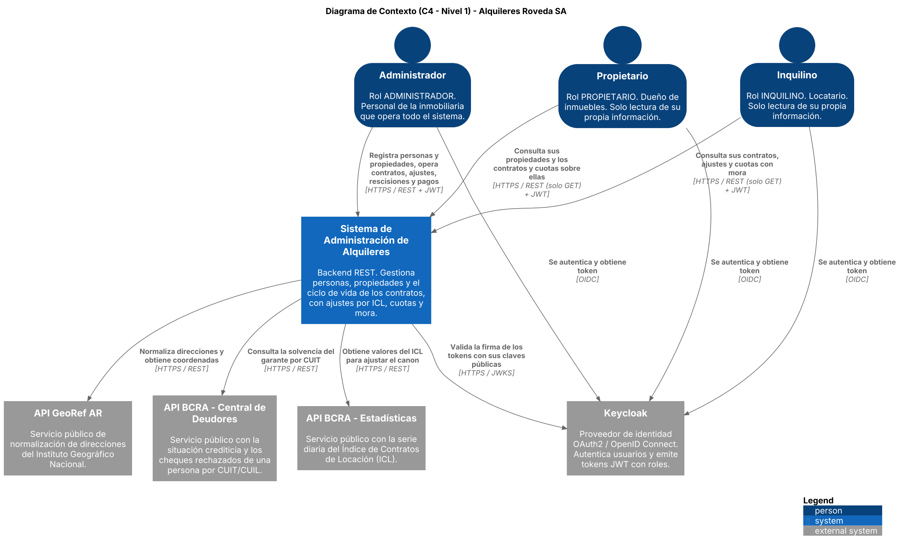
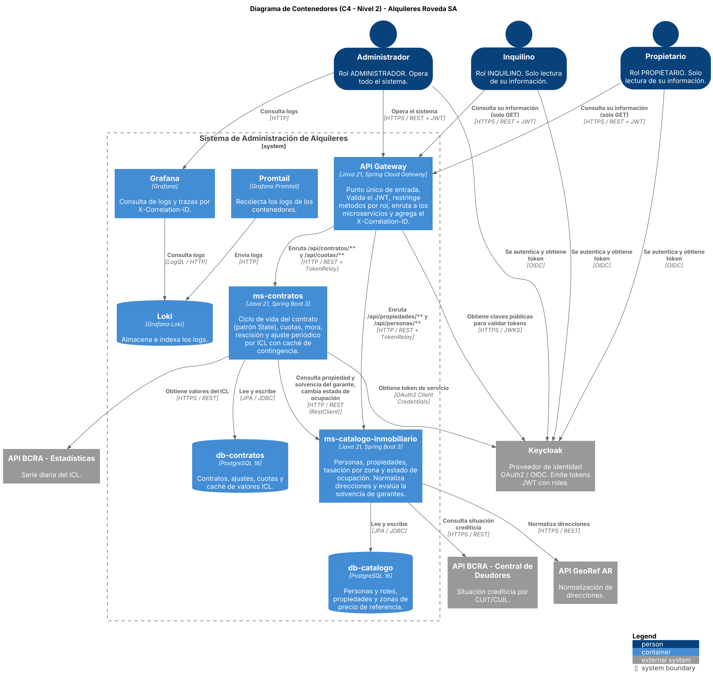
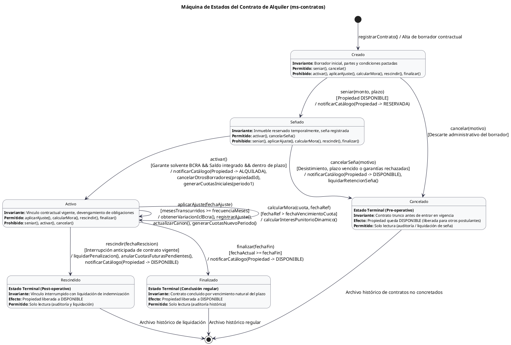

> [!INFO] Descripción del Dominio y Organización
> * Para ver el detalle redactado del dominio, servicios, bases de datos, APIs externas y roles de acceso, consultar [[Dominio]].
> * Para ver la asignación de responsabilidades de los 5 integrantes y la estrategia de trabajo, consultar [[PlanDeTrabajo]].

# Diagrama de Clases

```plantuml
@startuml
skinparam backgroundColor #FFFFFF
skinparam classAttributeIconSize 0
skinparam packageStyle rectangle
skinparam class {
    BackgroundColor #F8F9FA
    BorderColor #2B2D42
    ArrowColor #2B2D42
    FontName Arial
    FontSize 11
}

title Diagrama de Clases del Dominio - Sistema Backend de Administración de Alquileres

package "ms-catalogo-inmobiliario" {
    
    enum EstadoPropiedad <<enum>> {
        DISPONIBLE
        RESERVADA
        ALQUILADA
        INACTIVA
    }

    enum TipoPersonaEnum <<enum>> {
        PROPIETARIO
        INQUILINO
        GARANTE
    }

    enum TipologiaEnum <<enum>> {
        DEPARTAMENTO
        CASA
        PH
        LOCAL_COMERCIAL
        OFICINA
        COCHERA
        --
        - factorAjuste: BigDecimal
        + getFactorAjuste(): BigDecimal
    }

    class PrecioReferenciaZona {
        - id: Long
        - nombreZona: String
        - provincia: String
        - ciudad: String
        - latitudCentro: Double
        - longitudCentro: Double
        - radioMetros: Double
        - valorM2: BigDecimal
        - puntajeZona: Integer
        + estaDentroDelRadio(lat: Double, lon: Double): Boolean
    }

    class Persona {
        - id: Long
        - keycloakUserId: String
        - cuitCuil: String
        - nombre: String
        - apellido: String
        - email: String
        - telefono: String
        - roles: Set<TipoPersonaEnum>
        - ingresosMensualesDeclarados: BigDecimal
        - situacionCrediticiaBcra: Integer
        - chequesRechazados: Integer
        - fechaConsultaBcra: LocalDateTime
        + esGaranteSolvente(): Boolean
    }

    class Propiedad {
        - id: Long
        - codigo: String
        - tipologia: TipologiaEnum
        - calle: String
        - numero: String
        - piso: String
        - departamento: String
        - barrio: String
        - ciudad: String
        - provincia: String
        - latitud: Double
        - longitud: Double
        - superficieTotalM2: BigDecimal
        - superficieCubiertaM2: BigDecimal
        - precioSugeridoM2: BigDecimal
        - canonBaseSugerido: BigDecimal
        - estado: EstadoPropiedad
        + estaDisponible(): Boolean
        + reservar(): void
        + alquilar(): void
        + liberar(): void
    }

    Propiedad --> EstadoPropiedad : estado
    Propiedad --> TipologiaEnum : tipologia
    Propiedad --> PrecioReferenciaZona : zonaReferencia (0..1)
    Propiedad --> Persona : propietario (1)
    Propiedad --> Persona : inquilino (0..1)
    Propiedad --> Persona : garante (0..1)
    Persona --> TipoPersonaEnum : roles (Set)
}

package "ms-contratos" {

    enum EstadoContratoEnum <<enum>> {
        CREADO
        SENIADO
        ACTIVO
        CANCELADO
        RESCINDIDO
        FINALIZADO
    }

    interface EstadoContrato <<interface>> {
        + seniar(c: Contrato, monto: BigDecimal, fechaLimite: LocalDate): void
        + activar(c: Contrato): void
        + cancelar(c: Contrato, motivo: String): void
        + aplicarAjuste(c: Contrato, fechaAjuste: LocalDate, indiceDesde: BigDecimal, indiceHasta: BigDecimal): Ajuste
        + rescindir(c: Contrato, fechaRescision: LocalDate): BigDecimal
        + finalizar(c: Contrato): void
        + calcularMora(c: Contrato, diasAtraso: Integer): BigDecimal
    }

    class Creado implements EstadoContrato {
        + seniar(c: Contrato, monto: BigDecimal, fechaLimite: LocalDate): void
        + cancelar(c: Contrato, motivo: String): void
    }

    class Senado implements EstadoContrato {
        + activar(c: Contrato): void
        + cancelar(c: Contrato, motivo: String): void
    }

    class Activo implements EstadoContrato {
        + aplicarAjuste(c: Contrato, fechaAjuste: LocalDate, indiceDesde: BigDecimal, indiceHasta: BigDecimal): Ajuste
        + rescindir(c: Contrato, fechaRescision: LocalDate): BigDecimal
        + finalizar(c: Contrato): void
        + calcularMora(c: Contrato, diasAtraso: Integer): BigDecimal
    }

    class Cancelado implements EstadoContrato {
    }

    class Rescindido implements EstadoContrato {
    }

    class Finalizado implements EstadoContrato {
    }

    class Contrato {
        - id: Long
        - nroContrato: String
        - propiedadId: Long
        - propietarioId: Long
        - inquilinoId: Long
        - garanteId: Long
        - fechaInicio: LocalDate
        - fechaFin: LocalDate
        - fechaRescision: LocalDate
        - frecuenciaAjusteMeses: Integer
        - montoInicial: BigDecimal
        - montoActual: BigDecimal
        - propietarioKeycloakId: String
        - inquilinoKeycloakId: String
        - porcentajeMoraDiaria: BigDecimal
        - diaVencimientoMes: Integer
        - montoSenia: BigDecimal
        - fechaLimiteSenia: LocalDate
        - estadoEnum: EstadoContratoEnum
        - estadoActual: EstadoContrato
        + seniar(monto: BigDecimal, fechaLimite: LocalDate): void
        + activar(): void
        + cancelar(motivo: String): void
        + aplicarAjuste(fechaAjuste: LocalDate, indiceDesde: BigDecimal, indiceHasta: BigDecimal): Ajuste
        + generarCuotasPeriodoInicial(): List<Cuota>
        + generarCuotasAjuste(ajuste: Ajuste): List<Cuota>
        + anularCuotasFuturas(fechaCorte: LocalDate): void
        + rescindir(fechaRescision: LocalDate): BigDecimal
        + finalizar(): void
        + calcularMora(cuotaId: Long, fechaReferencia: LocalDate): BigDecimal
        + setEstado(nuevoEstado: EstadoContrato): void
    }

    class Ajuste {
        - id: Long
        - fechaAplicacion: LocalDate
        - fechaIndiceDesde: LocalDate
        - fechaIndiceHasta: LocalDate
        - valorIndiceDesde: BigDecimal
        - valorIndiceHasta: BigDecimal
        - montoAnterior: BigDecimal
        - montoNuevo: BigDecimal
        - porcentajeVariacion: BigDecimal
    }

    enum EstadoCuotaEnum <<enum>> {
        PENDIENTE
        PAGADA
        ANULADA
    }

    class Cuota {
        - id: Long
        - nroCuota: Integer
        - periodoMes: Integer
        - periodoAnio: Integer
        - fechaVencimiento: LocalDate
        - montoBase: BigDecimal
        - estado: EstadoCuotaEnum
        - fechaPago: LocalDate
        + calcularMora(fechaReferencia: LocalDate, porcentajeDiario: BigDecimal): BigDecimal
        + calcularTotalConMora(fechaReferencia: LocalDate, porcentajeDiario: BigDecimal): BigDecimal
        + estaVencida(fechaReferencia: LocalDate): Boolean
        + anular(): void
        + registrarPago(fechaPago: LocalDate): void
    }

    class IndiceIclCache {
        - id: Long
        - fecha: LocalDate
        - valor: BigDecimal
        - fechaConsulta: LocalDateTime
    }

    Contrato *--> "0..*" Ajuste : ajustes
    Contrato *--> "0..*" Cuota : cuotas (generadas bajo demanda)
    Cuota --> EstadoCuotaEnum : estado
    Contrato --> EstadoContratoEnum : estadoEnum
    Contrato o--> "1" EstadoContrato : estadoActual
    Contrato ..> IndiceIclCache : "consulta de contingencia"
}

package "inmobiliaria-commons (DTOs Inter-Servicio)" {
    class PropiedadDTO <<DTO>> {
        + id: Long
        + estado: String
        + propietarioId: Long
        + inquilinoId: Long
    }

    class ValidacionGaranteDTO <<DTO>> {
        + personaId: Long
        + cuitCuil: String
        + situacionCrediticia: Integer
        + chequesRechazados: Integer
        + esSolvente: Boolean
    }

    class ActualizarEstadoPropiedadDTO <<DTO>> {
        + nuevoEstado: String
        + inquilinoId: Long
    }
}

ms-contratos ..> "inmobiliaria-commons (DTOs Inter-Servicio)" : "importa DTOs"
ms-catalogo-inmobiliario ..> "inmobiliaria-commons (DTOs Inter-Servicio)" : "importa DTOs"
ms-contratos ..> ms-catalogo-inmobiliario : "comunicación sincrónica vía RestClient"

@enduml
```
# C4 - Contexto



```plantuml
@startuml C4_Contexto
!include https://raw.githubusercontent.com/plantuml-stdlib/C4-PlantUML/master/C4_Context.puml

LAYOUT_TOP_DOWN()
SHOW_PERSON_OUTLINE()

title Diagrama de Contexto (C4 - Nivel 1) - Alquileres Roveda SA

Person(admin, "Administrador", "Rol ADMINISTRADOR. Personal de la inmobiliaria que opera todo el sistema.")
Person(propietario, "Propietario", "Rol PROPIETARIO. Dueño de inmuebles. Solo lectura de su propia información.")
Person(inquilino, "Inquilino", "Rol INQUILINO. Locatario. Solo lectura de su propia información.")

System(sistema, "Sistema de Administración de Alquileres", "Backend REST. Gestiona personas, propiedades y el ciclo de vida de los contratos, con ajustes por ICL, cuotas y mora.")

System_Ext(keycloak, "Keycloak", "Proveedor de identidad OAuth2 / OpenID Connect. Autentica usuarios y emite tokens JWT con roles.")
System_Ext(georef, "API GeoRef AR", "Servicio público de normalización de direcciones del Instituto Geográfico Nacional.")
System_Ext(bcra_deudores, "API BCRA - Central de Deudores", "Servicio público con la situación crediticia y los cheques rechazados de una persona por CUIT/CUIL.")
System_Ext(bcra_estadisticas, "API BCRA - Estadísticas", "Servicio público con la serie diaria del Índice de Contratos de Locación (ICL).")

Rel(admin, sistema, "Registra personas y propiedades, opera contratos, ajustes, rescisiones y pagos", "HTTPS / REST + JWT")
Rel(propietario, sistema, "Consulta sus propiedades y los contratos y cuotas sobre ellas", "HTTPS / REST (solo GET) + JWT")
Rel(inquilino, sistema, "Consulta sus contratos, ajustes y cuotas con mora", "HTTPS / REST (solo GET) + JWT")

Rel(admin, keycloak, "Se autentica y obtiene token", "OIDC")
Rel(propietario, keycloak, "Se autentica y obtiene token", "OIDC")
Rel(inquilino, keycloak, "Se autentica y obtiene token", "OIDC")

Rel(sistema, keycloak, "Valida la firma de los tokens con sus claves públicas", "HTTPS / JWKS")
Rel(sistema, georef, "Normaliza direcciones y obtiene coordenadas", "HTTPS / REST")
Rel(sistema, bcra_deudores, "Consulta la solvencia del garante por CUIT", "HTTPS / REST")
Rel(sistema, bcra_estadisticas, "Obtiene valores del ICL para ajustar el canon", "HTTPS / REST")

SHOW_LEGEND()
@enduml
```

# C4 - Contenedores



```plantuml
@startuml C4_Contenedores
!include https://raw.githubusercontent.com/plantuml-stdlib/C4-PlantUML/master/C4_Container.puml

LAYOUT_TOP_DOWN()
SHOW_PERSON_OUTLINE()

title Diagrama de Contenedores (C4 - Nivel 2) - Alquileres Roveda SA

Person(admin, "Administrador", "Rol ADMINISTRADOR. Opera todo el sistema.")
Person(propietario, "Propietario", "Rol PROPIETARIO. Solo lectura de su información.")
Person(inquilino, "Inquilino", "Rol INQUILINO. Solo lectura de su información.")

System_Ext(keycloak, "Keycloak", "Proveedor de identidad OAuth2 / OIDC. Emite tokens JWT con roles.")
System_Ext(georef, "API GeoRef AR", "Normalización de direcciones.")
System_Ext(bcra_deudores, "API BCRA - Central de Deudores", "Situación crediticia por CUIT/CUIL.")
System_Ext(bcra_estadisticas, "API BCRA - Estadísticas", "Serie diaria del ICL.")

System_Boundary(sistema, "Sistema de Administración de Alquileres") {
    Container(api_gateway, "API Gateway", "Java 21, Spring Cloud Gateway", "Punto único de entrada. Valida el JWT, restringe métodos por rol, enruta a los microservicios y agrega el X-Correlation-ID.")
    Container(ms_catalogo, "ms-catalogo-inmobiliario", "Java 21, Spring Boot 3", "Personas, propiedades, tasación por zona y estado de ocupación. Normaliza direcciones y evalúa la solvencia de garantes.")
    Container(ms_contratos, "ms-contratos", "Java 21, Spring Boot 3", "Ciclo de vida del contrato (patrón State), cuotas, mora, rescisión y ajuste periódico por ICL con caché de contingencia.")
    ContainerDb(db_catalogo, "db-catalogo", "PostgreSQL 16", "Personas y roles, propiedades y zonas de precio de referencia.")
    ContainerDb(db_contratos, "db-contratos", "PostgreSQL 16", "Contratos, ajustes, cuotas y caché de valores ICL.")
    Container(promtail, "Promtail", "Grafana Promtail", "Recolecta los logs de los contenedores.")
    ContainerDb(loki, "Loki", "Grafana Loki", "Almacena e indexa los logs.")
    Container(grafana, "Grafana", "Grafana", "Consulta de logs y trazas por X-Correlation-ID.")
}

Rel(admin, keycloak, "Se autentica y obtiene token", "OIDC")
Rel(propietario, keycloak, "Se autentica y obtiene token", "OIDC")
Rel(inquilino, keycloak, "Se autentica y obtiene token", "OIDC")

Rel(admin, api_gateway, "Opera el sistema", "HTTPS / REST + JWT")
Rel(propietario, api_gateway, "Consulta su información (solo GET)", "HTTPS / REST + JWT")
Rel(inquilino, api_gateway, "Consulta su información (solo GET)", "HTTPS / REST + JWT")
Rel(admin, grafana, "Consulta logs", "HTTP")

Rel(api_gateway, keycloak, "Obtiene claves públicas para validar tokens", "HTTPS / JWKS")
Rel(api_gateway, ms_catalogo, "Enruta /api/propiedades/~*~* y /api/personas/~*~*", "HTTP / REST + TokenRelay")
Rel(api_gateway, ms_contratos, "Enruta /api/contratos/~*~* y /api/cuotas/~*~*", "HTTP / REST + TokenRelay")

Rel(ms_contratos, ms_catalogo, "Consulta propiedad y solvencia del garante, cambia estado de ocupación", "HTTP / REST (RestClient)")
Rel(ms_contratos, keycloak, "Obtiene token de servicio", "OAuth2 Client Credentials")

Rel(ms_catalogo, db_catalogo, "Lee y escribe", "JPA / JDBC")
Rel(ms_contratos, db_contratos, "Lee y escribe", "JPA / JDBC")

Rel(ms_catalogo, georef, "Normaliza direcciones", "HTTPS / REST")
Rel(ms_catalogo, bcra_deudores, "Consulta situación crediticia", "HTTPS / REST")
Rel(ms_contratos, bcra_estadisticas, "Obtiene valores del ICL", "HTTPS / REST")

Rel(promtail, loki, "Envía logs", "HTTP")
Rel(grafana, loki, "Consulta logs", "LogQL / HTTP")

SHOW_LEGEND()
@enduml
```

# Diagrama Entidad-Relación (DER)

```plantuml
@startuml DER
' Diagrama Entidad-Relación - notación pata de gallo (Information Engineering)
hide circle
skinparam linetype polyline
skinparam nodesep 80
skinparam ranksep 60
skinparam shadowing false
skinparam defaultFontName Arial
skinparam class {
    BackgroundColor #FFFFFF
    BorderColor #2B2D42
    ArrowColor #2B2D42
}
skinparam package {
    BorderColor #6C757D
    BackgroundColor #F8F9FA
}

title DER - Alquileres Roveda SA (Database per Service)

package "catalogo_db (PostgreSQL 16) - administrada por ms-catalogo-inmobiliario" {

    entity "personas" as personas {
        * id : BIGSERIAL <<PK>>
        --
        keycloak_user_id : VARCHAR <<UK>>
        * cuit_cuil : VARCHAR(11) <<UK>>
        * nombre : VARCHAR
        * apellido : VARCHAR
        email : VARCHAR <<UK>>
        telefono : VARCHAR
        ingresos_mensuales_declarados : NUMERIC(15,2)
        situacion_crediticia_bcra : INTEGER
        cheques_rechazados : INTEGER
        fecha_consulta_bcra : TIMESTAMP
        * fecha_alta : TIMESTAMP
        fecha_modificacion : TIMESTAMP
    }

    entity "persona_roles" as persona_roles {
        * persona_id : BIGINT <<PK, FK>>
        * rol : VARCHAR(20) <<PK>>
        --
        rol IN (PROPIETARIO, INQUILINO, GARANTE)
    }

    entity "propiedades" as propiedades {
        * id : BIGSERIAL <<PK>>
        --
        * codigo : VARCHAR(20) <<UK>>
        * tipologia : VARCHAR(30)
        * calle : VARCHAR
        * numero : VARCHAR(20)
        piso : VARCHAR(10)
        departamento : VARCHAR(10)
        barrio : VARCHAR
        * ciudad : VARCHAR(100)
        * provincia : VARCHAR(100)
        codigo_postal : VARCHAR(10)
        direccion_normalizada : VARCHAR
        latitud : DOUBLE
        longitud : DOUBLE
        * superficie_total_m2 : NUMERIC(10,2)
        superficie_cubierta_m2 : NUMERIC(10,2)
        precio_sugerido_m2 : NUMERIC(15,2)
        canon_base_sugerido : NUMERIC(15,2)
        * estado : VARCHAR(20)
        * version : BIGINT
        zona_referencia_id : BIGINT <<FK>>
        * propietario_id : BIGINT <<FK>>
        inquilino_id : BIGINT <<FK>>
        garante_id : BIGINT <<FK>>
        * fecha_alta : TIMESTAMP
        fecha_modificacion : TIMESTAMP
    }

    entity "precios_referencia_zona" as zonas {
        * id : BIGSERIAL <<PK>>
        --
        * nombre_zona : VARCHAR(100)
        * provincia : VARCHAR(100)
        * ciudad : VARCHAR(100)
        * provincia_normalizada : VARCHAR(100)
        * ciudad_normalizada : VARCHAR(100)
        latitud_centro : DOUBLE
        longitud_centro : DOUBLE
        radio_metros : INTEGER
        * valor_m2 : NUMERIC(15,2)
        * puntaje_zona : INTEGER
        * fecha_actualizacion : DATE
        UK (provincia_normalizada, ciudad_normalizada, nombre_zona)
    }
}

package "contratos_db (PostgreSQL 16) - administrada por ms-contratos" {

    entity "contratos" as contratos {
        * id : BIGSERIAL <<PK>>
        --
        * nro_contrato : VARCHAR(20) <<UK>>
        * propiedad_id : BIGINT <<ref. lógica>>
        * propietario_id : BIGINT <<ref. lógica>>
        * inquilino_id : BIGINT <<ref. lógica>>
        * garante_id : BIGINT <<ref. lógica>>
        * propietario_keycloak_id : VARCHAR
        * inquilino_keycloak_id : VARCHAR
        * fecha_inicio : DATE
        * fecha_fin : DATE
        fecha_rescision : DATE
        * frecuencia_ajuste_meses : INTEGER
        * monto_inicial : NUMERIC(15,2)
        * monto_actual : NUMERIC(15,2)
        * porcentaje_mora_diaria : NUMERIC(7,4)
        * dia_vencimiento_mes : INTEGER
        monto_senia : NUMERIC(15,2)
        fecha_limite_senia : DATE
        motivo_cancelacion : VARCHAR
        senia_retenida : BOOLEAN
        penalizacion_rescision : NUMERIC(15,2)
        * estado : VARCHAR(20)
        * version : BIGINT
        * fecha_alta : TIMESTAMP
        fecha_modificacion : TIMESTAMP
    }

    entity "ajustes" as ajustes {
        * id : BIGSERIAL <<PK>>
        --
        * contrato_id : BIGINT <<FK>>
        * fecha_aplicacion : DATE
        * fecha_indice_desde : DATE
        * fecha_indice_hasta : DATE
        * valor_indice_desde : NUMERIC(19,6)
        * valor_indice_hasta : NUMERIC(19,6)
        * monto_anterior : NUMERIC(15,2)
        * monto_nuevo : NUMERIC(15,2)
        * porcentaje_variacion : NUMERIC(9,4)
        UK (contrato_id, fecha_indice_hasta)
    }

    entity "cuotas" as cuotas {
        * id : BIGSERIAL <<PK>>
        --
        * contrato_id : BIGINT <<FK>>
        ajuste_id : BIGINT <<FK>>
        * nro_cuota : INTEGER
        * periodo_mes : INTEGER
        * periodo_anio : INTEGER
        * fecha_vencimiento : DATE
        * monto_base : NUMERIC(15,2)
        * estado : VARCHAR(20)
        fecha_pago : DATE
        UK (contrato_id, nro_cuota)
    }

    entity "indices_icl_cache" as icl {
        * id : BIGSERIAL <<PK>>
        --
        * fecha : DATE <<UK>>
        * valor : NUMERIC(19,6)
        * fecha_consulta : TIMESTAMP
    }
}

personas ||--|{ persona_roles : "tiene"
personas ||--o{ propiedades : "es propietario de"
personas |o--o{ propiedades : "es inquilino de"
personas |o--o{ propiedades : "es garante de"
zonas |o--o{ propiedades : "valoriza"

contratos ||--o{ ajustes : "registra"
contratos ||--o{ cuotas : "genera"
ajustes |o--o{ cuotas : "origina el lote de"

propiedades .. contratos : "referencia lógica por id\n(sin FK entre bases, se valida vía API)"

@enduml
```




# Máquina de Estados del Contrato (Patrón State)



