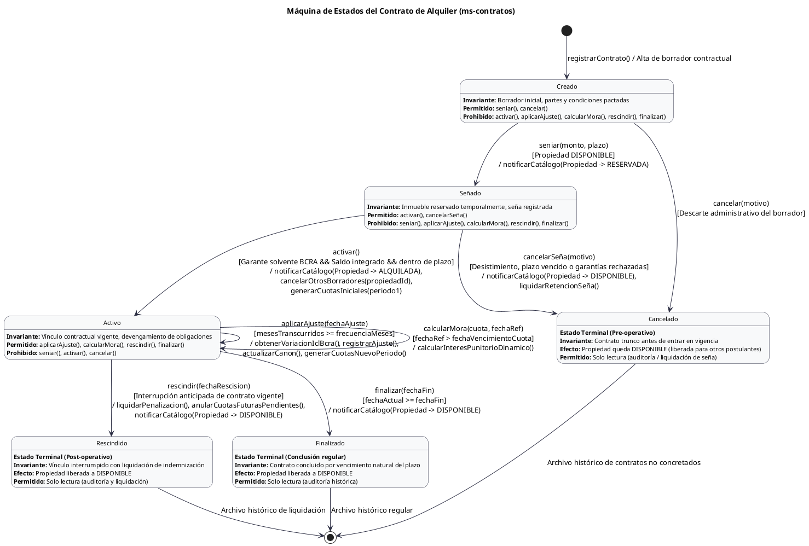

> [!INFO] Descripción del Dominio y Organización
> * Para ver el detalle redactado del dominio, servicios, bases de datos, APIs externas y roles de acceso, consultar [[Dominio]].
> * Para ver la asignación de responsabilidades de los 4 integrantes y la estrategia de trabajo, consultar [[PlanDeTrabajo]].

# Diagrama de Clases

```plantuml
@startuml
skinparam backgroundColor #FFFFFF
skinparam classAttributeIconSize 0
skinparam packageStyle rectangle
skinparam class {
    BackgroundColor #F8F9FA
    BorderColor #2B2D42
    ArrowColor #2B2D42
    FontName Arial
    FontSize 11
}

title Diagrama de Clases del Dominio - Sistema Backend de Administración de Alquileres

package "ms-catalogo-inmobiliario" {
    
    enum EstadoPropiedad <<enum>> {
        DISPONIBLE
        RESERVADA
        ALQUILADA
        INACTIVA
    }

    enum TipoPersonaEnum <<enum>> {
        PROPIETARIO
        INQUILINO
        GARANTE
    }

    class Persona {
        - id: Long
        - keycloakUserId: String
        - cuitCuil: String
        - nombre: String
        - apellido: String
        - email: String
        - telefono: String
        - tipoPersona: TipoPersonaEnum
        - ingresosMensualesDeclarados: BigDecimal
        - situacionCrediticiaBcra: Integer
        - chequesRechazados: Integer
        - fechaConsultaBcra: LocalDateTime
        + esGaranteSolvente(): Boolean
    }

    class Propiedad {
        - id: Long
        - codigo: String
        - tipologia: String
        - calle: String
        - numero: String
        - piso: String
        - departamento: String
        - barrio: String
        - ciudad: String
        - provincia: String
        - latitud: Double
        - longitud: Double
        - superficieTotalM2: BigDecimal
        - superficieCubiertaM2: BigDecimal
        - precioSugeridoM2: BigDecimal
        - canonBaseSugerido: BigDecimal
        - propietarioId: Long
        - inquilinoId: Long
        - garanteId: Long
        - estado: EstadoPropiedad
        + estaDisponible(): Boolean
        + reservar(): void
        + alquilar(): void
        + liberar(): void
    }

    Propiedad --> EstadoPropiedad : estado
    Persona --> TipoPersonaEnum : tipoPersona
    Propiedad ..> Persona : "propietarioId / inquilinoId / garanteId (FK lógica)"
}

package "ms-contratos" {

    enum EstadoContratoEnum <<enum>> {
        CREADO
        SENIADO
        ACTIVO
        CANCELADO
        RESCINDIDO
        FINALIZADO
    }

    interface EstadoContrato <<interface>> {
        + seniar(c: Contrato, monto: BigDecimal, fechaLimite: LocalDate): void
        + activar(c: Contrato): void
        + cancelar(c: Contrato, motivo: String): void
        + aplicarAjuste(c: Contrato, fechaAjuste: LocalDate, indiceDesde: BigDecimal, indiceHasta: BigDecimal): Ajuste
        + rescindir(c: Contrato, fechaRescision: LocalDate): BigDecimal
        + finalizar(c: Contrato): void
        + calcularMora(c: Contrato, diasAtraso: Integer): BigDecimal
    }

    class Creado implements EstadoContrato {
        + seniar(c: Contrato, monto: BigDecimal, fechaLimite: LocalDate): void
        + cancelar(c: Contrato, motivo: String): void
    }

    class Senado implements EstadoContrato {
        + activar(c: Contrato): void
        + cancelar(c: Contrato, motivo: String): void
    }

    class Activo implements EstadoContrato {
        + aplicarAjuste(c: Contrato, fechaAjuste: LocalDate, indiceDesde: BigDecimal, indiceHasta: BigDecimal): Ajuste
        + rescindir(c: Contrato, fechaRescision: LocalDate): BigDecimal
        + finalizar(c: Contrato): void
        + calcularMora(c: Contrato, diasAtraso: Integer): BigDecimal
    }

    class Cancelado implements EstadoContrato {
    }

    class Rescindido implements EstadoContrato {
    }

    class Finalizado implements EstadoContrato {
    }

    class Contrato {
        - id: Long
        - nroContrato: String
        - propiedadId: Long
        - propietarioId: Long
        - inquilinoId: Long
        - garanteId: Long
        - fechaInicio: LocalDate
        - fechaFin: LocalDate
        - fechaRescision: LocalDate
        - frecuenciaAjusteMeses: Integer
        - montoInicial: BigDecimal
        - montoActual: BigDecimal
        - moneda: String
        - porcentajeMoraDiaria: BigDecimal
        - diaVencimientoMes: Integer
        - montoSenia: BigDecimal
        - fechaLimiteSenia: LocalDate
        - estadoEnum: EstadoContratoEnum
        - estadoActual: EstadoContrato
        + seniar(monto: BigDecimal, fechaLimite: LocalDate): void
        + activar(): void
        + cancelar(motivo: String): void
        + aplicarAjuste(fechaAjuste: LocalDate, indiceDesde: BigDecimal, indiceHasta: BigDecimal): Ajuste
        + generarCuotasPeriodoInicial(): List<Cuota>
        + generarCuotasAjuste(ajuste: Ajuste): List<Cuota>
        + anularCuotasFuturas(fechaCorte: LocalDate): void
        + rescindir(fechaRescision: LocalDate): BigDecimal
        + finalizar(): void
        + calcularMora(cuotaId: Long, fechaReferencia: LocalDate): BigDecimal
        + setEstado(nuevoEstado: EstadoContrato): void
    }

    class Ajuste {
        - id: Long
        - fechaAplicacion: LocalDate
        - fechaIndiceDesde: LocalDate
        - fechaIndiceHasta: LocalDate
        - valorIndiceDesde: BigDecimal
        - valorIndiceHasta: BigDecimal
        - montoAnterior: BigDecimal
        - montoNuevo: BigDecimal
        - porcentajeVariacion: BigDecimal
    }

    enum EstadoCuotaEnum <<enum>> {
        PENDIENTE
        ANULADA
    }

    class Cuota {
        - id: Long
        - nroCuota: Integer
        - periodoMes: Integer
        - periodoAnio: Integer
        - fechaVencimiento: LocalDate
        - montoBase: BigDecimal
        - estado: EstadoCuotaEnum
        + calcularMora(fechaReferencia: LocalDate, porcentajeDiario: BigDecimal): BigDecimal
        + calcularTotalConMora(fechaReferencia: LocalDate, porcentajeDiario: BigDecimal): BigDecimal
        + estaVencida(fechaReferencia: LocalDate): Boolean
        + anular(): void
    }

    class IndiceIclCache {
        - id: Long
        - fecha: LocalDate
        - valor: BigDecimal
        - fechaConsulta: LocalDateTime
    }

    Contrato *--> "0..*" Ajuste : ajustes
    Contrato *--> "0..*" Cuota : cuotas (generadas bajo demanda)
    Cuota --> EstadoCuotaEnum : estado
    Contrato --> EstadoContratoEnum : estadoEnum
    Contrato o--> "1" EstadoContrato : estadoActual
    Contrato ..> IndiceIclCache : "consulta de contingencia"
}

package "inmobiliaria-commons (DTOs Inter-Servicio)" {
    class PropiedadDTO <<DTO>> {
        + id: Long
        + estado: String
        + propietarioId: Long
        + inquilinoId: Long
    }

    class ValidacionGaranteDTO <<DTO>> {
        + personaId: Long
        + cuitCuil: String
        + situacionCrediticia: Integer
        + chequesRechazados: Integer
        + esSolvente: Boolean
    }

    class ActualizarEstadoPropiedadDTO <<DTO>> {
        + nuevoEstado: String
        + inquilinoId: Long
    }
}

ms-contratos ..> "inmobiliaria-commons (DTOs Inter-Servicio)" : "importa DTOs"
ms-catalogo-inmobiliario ..> "inmobiliaria-commons (DTOs Inter-Servicio)" : "importa DTOs"
ms-contratos ..> ms-catalogo-inmobiliario : "comunicación sincrónica vía RestClient"

@enduml
```
# C4 - Contexto

```plantuml
@startuml
!include https://raw.githubusercontent.com/plantuml-stdlib/C4-PlantUML/master/C4_Context.puml

LAYOUT_LEFT_RIGHT()
SHOW_PERSON_OUTLINE()

title Diagrama de Contexto (C1) - Sistema de Administración de Alquileres

' Actores del dominio con aislamiento estricto por rol
Person(admin, "Administrador de Propiedades", "Rol: ADMINISTRADOR. Opera integralmente el sistema: registra clientes y propiedades, evalúa garantes y gestiona todo el ciclo de vida de los contratos.")
Person(propietario, "Propietario", "Rol: PROPIETARIO (Solo Lectura). Delega la administración. Consulta exclusivamente sus propiedades y los contratos celebrados sobre esas propiedades.")
Person(inquilino, "Inquilino", "Rol: INQUILINO (Solo Lectura). Consulta exclusivamente sus propios contratos de alquiler, canon actual e historial de aumentos.")

' Sistema en estudio
System(sistema_alquileres, "Sistema Backend de Administración de Alquileres", "Centraliza la operación inmobiliaria para los administradores y brinda transparencia de consulta a propietarios e inquilinos.")

' Sistemas Externos
System_Ext(keycloak, "Keycloak Identity Provider", "Servidor OIDC / OAuth2. Autentica usuarios y emite tokens JWT con roles (ADMINISTRADOR, PROPIETARIO, INQUILINO).")
System_Ext(api_bcra, "API Pública BCRA", "Provee Central de Deudores (riesgo crediticio por CUIT) y Principales Variables (Índice ICL para aumentos).")
System_Ext(api_georef, "API Pública GeoRef AR", "Normaliza direcciones y obtiene coordenadas (lat/lon) al registrar propiedades.")

' Relaciones de los actores
Rel(admin, sistema_alquileres, "Gestiona catálogo y opera ciclo de vida de contratos (Lectura y Escritura)", "HTTPS / JSON")
Rel(propietario, sistema_alquileres, "Consulta sus propiedades y contratos de esas propiedades (Solo GET)", "HTTPS / JSON")
Rel(inquilino, sistema_alquileres, "Consulta únicamente sus propios contratos de alquiler (Solo GET)", "HTTPS / JSON")

' Relaciones hacia sistemas externos
Rel(sistema_alquileres, keycloak, "Valida tokens JWT y roles de acceso", "OIDC / JWKS (HTTPS)")
Rel(sistema_alquileres, api_bcra, "Evalúa solvencia de garantes y consulta índice ICL", "REST / HTTPS")
Rel(sistema_alquileres, api_georef, "Geocodifica y normaliza direcciones de propiedades", "REST / HTTPS")

@enduml
```
# C4 - Contenedores


```plantuml
@startuml
!include https://raw.githubusercontent.com/plantuml-stdlib/C4-PlantUML/master/C4_Container.puml

LAYOUT_TOP_DOWN()
SHOW_PERSON_OUTLINE()

title Diagrama de Contenedores (C2) - Sistema Backend de Administración de Alquileres

' Actores diferenciados por permisos (Escritura vs Solo Lectura)
Person(admin, "Administrador", "Rol: ADMINISTRADOR.\nGestiona integralmente el sistema (Altas, bajas, señas, activación de contratos, aplicación de ajustes y rescisiones).")
Person(propietario, "Propietario", "Rol: PROPIETARIO (Solo Lectura).\nDelega la administración. Consulta únicamente sus propiedades y los contratos celebrados sobre esas propiedades.")
Person(inquilino, "Inquilino", "Rol: INQUILINO (Solo Lectura).\nConsulta únicamente sus propios contratos de alquiler vigentes, montos actualizados e historial de aumentos.")

' Sistemas Externos exigidos por la arquitectura
System_Ext(keycloak, "Keycloak Identity Provider", "Servidor OIDC / OAuth2.\nAutentica usuarios, emite tokens JWT y administra los roles (ADMINISTRADOR, PROPIETARIO, INQUILINO).")
System_Ext(api_bcra, "API Pública BCRA", "1) Central de Deudores (/centraldedeudores/v1.0/deudas/{cuit})\n2) Estadísticas ICL (/estadisticas/v2.0/principalesvariables)")
System_Ext(api_georef, "API Pública GeoRef AR", "API de Datos Geográficos (datos.gob.ar).\nNormaliza direcciones y devuelve coordenadas (lat/lon) al registrar inmuebles.")

' Límite del Sistema Backend (Red Docker Compose)
System_Boundary(sistema_backend, "Sistema Backend TPI (Docker Compose Network)") {

    Container(api_gateway, "API Gateway", "Java 21 / Spring Cloud Gateway", "Punto único de entrada.\nEnruta peticiones y aplica Security Filter: valida firma JWT y controla que POST/PUT/PATCH solo sean de ADMINISTRADOR y GET para consultas.")

    Container(ms_catalogo, "ms-catalogo-inmobiliario", "Java 21 / Spring Boot 3", "Responsabilidad: Administra Propiedades y Personas.\nNormaliza direcciones (GeoRef), evalúa solvencia de garantes (BCRA) y gestiona estados del bien (DISPONIBLE, RESERVADA, ALQUILADA).")

    Container(ms_contratos, "ms-contratos", "Java 21 / Spring Boot 3", "Responsabilidad: Gestiona el ciclo de vida de Contratos (Patrón State: Creado, Señado, Activo, Cancelado, Rescindido, Finalizado), calcula aumentos por ICL (BCRA) y liquida penalizaciones/señas.")

    Container(commons_jar, "inmobiliaria-commons", "Artefacto Maven (.jar)", "Componente común reutilizable.\nContiene DTOs de comunicación inter-servicio, manejo global de excepciones (ApiError) y utilidades de extracción de claims JWT.")

    ContainerDb(db_catalogo, "DB Catálogo", "PostgreSQL (Esquema Catálogo)", "Persiste tablas: propiedades, personas y caché de situación crediticia BCRA.")

    ContainerDb(db_contratos, "DB Contratos", "PostgreSQL (Esquema Contratos)", "Persiste tablas: contratos (con propietarioId e inquilinoId), ajustes y caché de índices ICL (fallback).")
}

' 1. Flujo de Autenticación de los Actores con Keycloak
Rel(admin, keycloak, "Obtiene JWT (Rol: ADMINISTRADOR)", "OIDC / HTTPS")
Rel(propietario, keycloak, "Obtiene JWT (Rol: PROPIETARIO)", "OIDC / HTTPS")
Rel(inquilino, keycloak, "Obtiene JWT (Rol: INQUILINO)", "OIDC / HTTPS")

' 2. Interacción de los Actores hacia el API Gateway
Rel(admin, api_gateway, "Registra propiedades/personas y opera contratos", "REST (GET, POST, PUT, PATCH) + Bearer JWT")
Rel(propietario, api_gateway, "Consulta sus propiedades y contratos de esas propiedades", "REST (Solo GET) + Bearer JWT")
Rel(inquilino, api_gateway, "Consulta únicamente sus propios contratos de alquiler", "REST (Solo GET) + Bearer JWT")

' 3. Validación del Gateway con Keycloak y Enrutamiento interno
Rel(api_gateway, keycloak, "Valida firma del JWT y roles (JWK Set URI)", "HTTPS")
Rel(api_gateway, ms_catalogo, "Enruta /api/propiedades/** y /api/personas/**", "HTTP + TokenRelay")
Rel(api_gateway, ms_contratos, "Enruta /api/contratos/**", "HTTP + TokenRelay")

' 4. Colaboración funcional entre Microservicios
Rel_R(ms_contratos, ms_catalogo, "1) Valida propiedad DISPONIBLE, solvencia de garante y obtiene propietarioId\n2) Cambia estado a RESERVADA / ALQUILADA / DISPONIBLE", "Spring RestClient / HTTP")

' 5. Uso del Componente Común (.jar)
Rel_D(ms_catalogo, commons_jar, "Importa dependencia en pom.xml", "Maven .jar")
Rel_D(ms_contratos, commons_jar, "Importa dependencia en pom.xml", "Maven .jar")

' 6. Persistencia en Bases de Datos
Rel_D(ms_catalogo, db_catalogo, "Lee y escribe entidades", "Spring Data JPA / JDBC")
Rel_D(ms_contratos, db_contratos, "Lee y escribe entidades", "Spring Data JPA / JDBC")

' 7. Consumo de APIs Públicas Externas
Rel(ms_catalogo, api_georef, "Normaliza dirección y obtiene lat/lon en alta de propiedad", "RestClient / HTTPS")
Rel(ms_catalogo, api_bcra, "Verifica situación crediticia del garante por CUIT", "RestClient / HTTPS")
Rel(ms_contratos, api_bcra, "Obtiene variación del índice ICL entre fechas para aplicar ajuste", "RestClient / HTTPS")

@enduml
```

# Máquina de Estados del Contrato (Patrón State)



