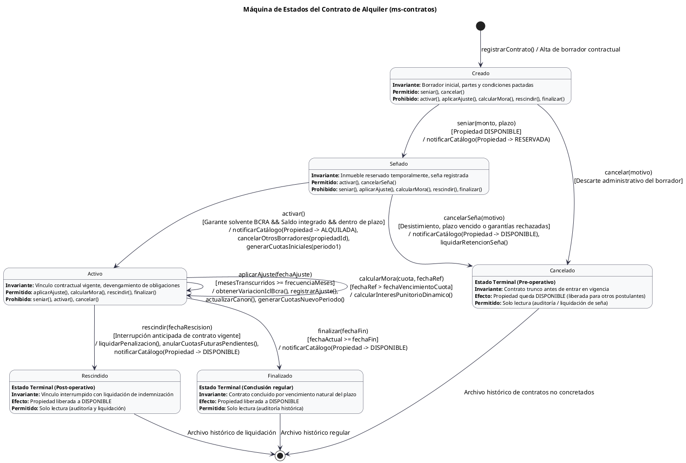

> [!INFO] Descripción del Dominio y Organización
> * Para ver el detalle redactado del dominio, servicios, bases de datos, APIs externas y roles de acceso, consultar [[Dominio]].
> * Para ver la asignación de responsabilidades de los 4 integrantes y la estrategia de trabajo, consultar [[PlanDeTrabajo]].

# Diagrama de Clases

```plantuml
@startuml
skinparam backgroundColor #FFFFFF
skinparam classAttributeIconSize 0
skinparam packageStyle rectangle
skinparam class {
    BackgroundColor #F8F9FA
    BorderColor #2B2D42
    ArrowColor #2B2D42
    FontName Arial
    FontSize 11
}

title Diagrama de Clases del Dominio - Sistema Backend de Administración de Alquileres

package "ms-catalogo-inmobiliario" {
    
    enum EstadoPropiedad <<enum>> {
        DISPONIBLE
        RESERVADA
        ALQUILADA
        INACTIVA
    }

    enum TipoPersonaEnum <<enum>> {
        PROPIETARIO
        INQUILINO
        GARANTE
    }

    enum TipologiaEnum <<enum>> {
        DEPARTAMENTO
        CASA
        PH
        LOCAL_COMERCIAL
        OFICINA
        COCHERA
        --
        - factorAjuste: BigDecimal
        + getFactorAjuste(): BigDecimal
    }

    class PrecioReferenciaZona {
        - id: Long
        - nombreZona: String
        - provincia: String
        - ciudad: String
        - latitudCentro: Double
        - longitudCentro: Double
        - radioMetros: Double
        - valorM2: BigDecimal
        - puntajeZona: Integer
        + estaDentroDelRadio(lat: Double, lon: Double): Boolean
    }

    class Persona {
        - id: Long
        - keycloakUserId: String
        - cuitCuil: String
        - nombre: String
        - apellido: String
        - email: String
        - telefono: String
        - roles: Set<TipoPersonaEnum>
        - ingresosMensualesDeclarados: BigDecimal
        - situacionCrediticiaBcra: Integer
        - chequesRechazados: Integer
        - fechaConsultaBcra: LocalDateTime
        + esGaranteSolvente(): Boolean
    }

    class Propiedad {
        - id: Long
        - codigo: String
        - tipologia: TipologiaEnum
        - calle: String
        - numero: String
        - piso: String
        - departamento: String
        - barrio: String
        - ciudad: String
        - provincia: String
        - latitud: Double
        - longitud: Double
        - superficieTotalM2: BigDecimal
        - superficieCubiertaM2: BigDecimal
        - precioSugeridoM2: BigDecimal
        - canonBaseSugerido: BigDecimal
        - estado: EstadoPropiedad
        + estaDisponible(): Boolean
        + reservar(): void
        + alquilar(): void
        + liberar(): void
    }

    Propiedad --> EstadoPropiedad : estado
    Propiedad --> TipologiaEnum : tipologia
    Propiedad --> PrecioReferenciaZona : zonaReferencia (0..1)
    Propiedad --> Persona : propietario (1)
    Propiedad --> Persona : inquilino (0..1)
    Propiedad --> Persona : garante (0..1)
    Persona --> TipoPersonaEnum : roles (Set)
}

package "ms-contratos" {

    enum EstadoContratoEnum <<enum>> {
        CREADO
        SENIADO
        ACTIVO
        CANCELADO
        RESCINDIDO
        FINALIZADO
    }

    interface EstadoContrato <<interface>> {
        + seniar(c: Contrato, monto: BigDecimal, fechaLimite: LocalDate): void
        + activar(c: Contrato): void
        + cancelar(c: Contrato, motivo: String): void
        + aplicarAjuste(c: Contrato, fechaAjuste: LocalDate, indiceDesde: BigDecimal, indiceHasta: BigDecimal): Ajuste
        + rescindir(c: Contrato, fechaRescision: LocalDate): BigDecimal
        + finalizar(c: Contrato): void
        + calcularMora(c: Contrato, diasAtraso: Integer): BigDecimal
    }

    class Creado implements EstadoContrato {
        + seniar(c: Contrato, monto: BigDecimal, fechaLimite: LocalDate): void
        + cancelar(c: Contrato, motivo: String): void
    }

    class Senado implements EstadoContrato {
        + activar(c: Contrato): void
        + cancelar(c: Contrato, motivo: String): void
    }

    class Activo implements EstadoContrato {
        + aplicarAjuste(c: Contrato, fechaAjuste: LocalDate, indiceDesde: BigDecimal, indiceHasta: BigDecimal): Ajuste
        + rescindir(c: Contrato, fechaRescision: LocalDate): BigDecimal
        + finalizar(c: Contrato): void
        + calcularMora(c: Contrato, diasAtraso: Integer): BigDecimal
    }

    class Cancelado implements EstadoContrato {
    }

    class Rescindido implements EstadoContrato {
    }

    class Finalizado implements EstadoContrato {
    }

    class Contrato {
        - id: Long
        - nroContrato: String
        - propiedadId: Long
        - propietarioId: Long
        - inquilinoId: Long
        - garanteId: Long
        - fechaInicio: LocalDate
        - fechaFin: LocalDate
        - fechaRescision: LocalDate
        - frecuenciaAjusteMeses: Integer
        - montoInicial: BigDecimal
        - montoActual: BigDecimal
        - moneda: String
        - porcentajeMoraDiaria: BigDecimal
        - diaVencimientoMes: Integer
        - montoSenia: BigDecimal
        - fechaLimiteSenia: LocalDate
        - estadoEnum: EstadoContratoEnum
        - estadoActual: EstadoContrato
        + seniar(monto: BigDecimal, fechaLimite: LocalDate): void
        + activar(): void
        + cancelar(motivo: String): void
        + aplicarAjuste(fechaAjuste: LocalDate, indiceDesde: BigDecimal, indiceHasta: BigDecimal): Ajuste
        + generarCuotasPeriodoInicial(): List<Cuota>
        + generarCuotasAjuste(ajuste: Ajuste): List<Cuota>
        + anularCuotasFuturas(fechaCorte: LocalDate): void
        + rescindir(fechaRescision: LocalDate): BigDecimal
        + finalizar(): void
        + calcularMora(cuotaId: Long, fechaReferencia: LocalDate): BigDecimal
        + setEstado(nuevoEstado: EstadoContrato): void
    }

    class Ajuste {
        - id: Long
        - fechaAplicacion: LocalDate
        - fechaIndiceDesde: LocalDate
        - fechaIndiceHasta: LocalDate
        - valorIndiceDesde: BigDecimal
        - valorIndiceHasta: BigDecimal
        - montoAnterior: BigDecimal
        - montoNuevo: BigDecimal
        - porcentajeVariacion: BigDecimal
    }

    enum EstadoCuotaEnum <<enum>> {
        PENDIENTE
        ANULADA
    }

    class Cuota {
        - id: Long
        - nroCuota: Integer
        - periodoMes: Integer
        - periodoAnio: Integer
        - fechaVencimiento: LocalDate
        - montoBase: BigDecimal
        - estado: EstadoCuotaEnum
        + calcularMora(fechaReferencia: LocalDate, porcentajeDiario: BigDecimal): BigDecimal
        + calcularTotalConMora(fechaReferencia: LocalDate, porcentajeDiario: BigDecimal): BigDecimal
        + estaVencida(fechaReferencia: LocalDate): Boolean
        + anular(): void
    }

    class IndiceIclCache {
        - id: Long
        - fecha: LocalDate
        - valor: BigDecimal
        - fechaConsulta: LocalDateTime
    }

    Contrato *--> "0..*" Ajuste : ajustes
    Contrato *--> "0..*" Cuota : cuotas (generadas bajo demanda)
    Cuota --> EstadoCuotaEnum : estado
    Contrato --> EstadoContratoEnum : estadoEnum
    Contrato o--> "1" EstadoContrato : estadoActual
    Contrato ..> IndiceIclCache : "consulta de contingencia"
}

package "inmobiliaria-commons (DTOs Inter-Servicio)" {
    class PropiedadDTO <<DTO>> {
        + id: Long
        + estado: String
        + propietarioId: Long
        + inquilinoId: Long
    }

    class ValidacionGaranteDTO <<DTO>> {
        + personaId: Long
        + cuitCuil: String
        + situacionCrediticia: Integer
        + chequesRechazados: Integer
        + esSolvente: Boolean
    }

    class ActualizarEstadoPropiedadDTO <<DTO>> {
        + nuevoEstado: String
        + inquilinoId: Long
    }
}

ms-contratos ..> "inmobiliaria-commons (DTOs Inter-Servicio)" : "importa DTOs"
ms-catalogo-inmobiliario ..> "inmobiliaria-commons (DTOs Inter-Servicio)" : "importa DTOs"
ms-contratos ..> ms-catalogo-inmobiliario : "comunicación sincrónica vía RestClient"

@enduml
```
# C4 - Contexto


```plantuml
@startuml C4_Contexto
!include https://raw.githubusercontent.com/plantuml-stdlib/C4-PlantUML/master/C4_Context.puml

LAYOUT_TOP_DOWN()
SHOW_PERSON_OUTLINE()

title Diagrama de Contexto (C4 - Nivel 1) - Alquileres Roveda SA

Person(admin, "Administrador", "Rol ADMINISTRADOR. Personal de la inmobiliaria que opera todo el sistema.")
Person(propietario, "Propietario", "Rol PROPIETARIO. Dueño de inmuebles. Solo lectura de su propia información.")
Person(inquilino, "Inquilino", "Rol INQUILINO. Locatario. Solo lectura de su propia información.")

System(sistema, "Sistema de Administración de Alquileres", "Backend REST. Gestiona personas, propiedades y el ciclo de vida de los contratos, con ajustes por ICL, cuotas y mora.")

System_Ext(keycloak, "Keycloak", "Proveedor de identidad OAuth2 / OpenID Connect. Autentica usuarios y emite tokens JWT con roles.")
System_Ext(georef, "API GeoRef AR", "Servicio público de normalización de direcciones del Instituto Geográfico Nacional.")
System_Ext(bcra_deudores, "API BCRA - Central de Deudores", "Servicio público con la situación crediticia y los cheques rechazados de una persona por CUIT/CUIL.")
System_Ext(bcra_estadisticas, "API BCRA - Estadísticas", "Servicio público con la serie diaria del Índice de Contratos de Locación (ICL).")

Rel(admin, sistema, "Registra personas y propiedades, opera contratos, ajustes, rescisiones y pagos", "HTTPS / REST + JWT")
Rel(propietario, sistema, "Consulta sus propiedades y los contratos y cuotas sobre ellas", "HTTPS / REST (solo GET) + JWT")
Rel(inquilino, sistema, "Consulta sus contratos, ajustes y cuotas con mora", "HTTPS / REST (solo GET) + JWT")

Rel(admin, keycloak, "Se autentica y obtiene token", "OIDC")
Rel(propietario, keycloak, "Se autentica y obtiene token", "OIDC")
Rel(inquilino, keycloak, "Se autentica y obtiene token", "OIDC")

Rel(sistema, keycloak, "Valida la firma de los tokens con sus claves públicas", "HTTPS / JWKS")
Rel(sistema, georef, "Normaliza direcciones y obtiene coordenadas", "HTTPS / REST")
Rel(sistema, bcra_deudores, "Consulta la solvencia del garante por CUIT", "HTTPS / REST")
Rel(sistema, bcra_estadisticas, "Obtiene valores del ICL para ajustar el canon", "HTTPS / REST")

SHOW_LEGEND()
@enduml
```

# C4 - Contenedores


```plantuml
@startuml
!include https://raw.githubusercontent.com/plantuml-stdlib/C4-PlantUML/master/C4_Container.puml

LAYOUT_TOP_DOWN()
SHOW_PERSON_OUTLINE()

title Diagrama de Contenedores (C2) - Sistema Backend de Administración de Alquileres

' Actores diferenciados por permisos (Escritura vs Solo Lectura)
Person(admin, "Administrador", "Rol: ADMINISTRADOR.\nGestiona integralmente el sistema (Altas, bajas, señas, activación de contratos, aplicación de ajustes y rescisiones).")
Person(propietario, "Propietario", "Rol: PROPIETARIO (Solo Lectura).\nDelega la administración. Consulta únicamente sus propiedades y los contratos celebrados sobre esas propiedades.")
Person(inquilino, "Inquilino", "Rol: INQUILINO (Solo Lectura).\nConsulta únicamente sus propios contratos de alquiler vigentes, montos actualizados e historial de aumentos.")

' Sistemas Externos exigidos por la arquitectura
System_Ext(keycloak, "Keycloak Identity Provider", "Servidor OIDC / OAuth2.\nAutentica usuarios, emite tokens JWT y administra los roles (ADMINISTRADOR, PROPIETARIO, INQUILINO).")
System_Ext(api_bcra, "API Pública BCRA", "1) Central de Deudores (/centraldedeudores/v1.0/deudas/{cuit})\n2) Estadísticas ICL (/estadisticas/v2.0/principalesvariables)")
System_Ext(api_georef, "API Pública GeoRef AR", "API de Datos Geográficos (datos.gob.ar).\nNormaliza direcciones y devuelve coordenadas (lat/lon) al registrar inmuebles.")

' Límite del Sistema Backend (Red Docker Compose)
System_Boundary(sistema_backend, "Sistema Backend TPI (Docker Compose Network)") {

    Container(api_gateway, "API Gateway", "Java 21 / Spring Cloud Gateway", "Punto único de entrada.\nEnruta peticiones y aplica Security Filter: valida firma JWT y controla que POST/PUT/PATCH solo sean de ADMINISTRADOR y GET para consultas.")

    Container(ms_catalogo, "ms-catalogo-inmobiliario", "Java 21 / Spring Boot 3", "Responsabilidad: Administra Propiedades y Personas.\nNormaliza direcciones (GeoRef), evalúa solvencia de garantes (BCRA) y gestiona estados del bien (DISPONIBLE, RESERVADA, ALQUILADA).")

    Container(ms_contratos, "ms-contratos", "Java 21 / Spring Boot 3", "Responsabilidad: Gestiona el ciclo de vida de Contratos (Patrón State: Creado, Señado, Activo, Cancelado, Rescindido, Finalizado), calcula aumentos por ICL (BCRA) y liquida penalizaciones/señas.")

    Container(commons_jar, "inmobiliaria-commons", "Artefacto Maven (.jar)", "Componente común reutilizable.\nContiene DTOs de comunicación inter-servicio, manejo global de excepciones (ApiError) y utilidades de extracción de claims JWT.")

    ContainerDb(db_catalogo, "DB Catálogo", "PostgreSQL (Esquema Catálogo)", "Persiste tablas: propiedades, personas y caché de situación crediticia BCRA.")

    ContainerDb(db_contratos, "DB Contratos", "PostgreSQL (Esquema Contratos)", "Persiste tablas: contratos (con propietarioId e inquilinoId), ajustes y caché de índices ICL (fallback).")

    ' Subsistema de Observabilidad y Centralización de Logs (Stack PLG)
    Container(promtail, "Promtail", "Daemon / Agente", "Recolecta automáticamente streams stdout/stderr de todos los contenedores Docker mediante el socket de Docker.")
    ContainerDb(loki, "Loki", "Log Storage Engine", "Persiste y comprime flujos de logs en volumen dedicado, indexados por labels de contenedor.")
    Container(grafana, "Grafana", "Dashboard Web (:3000)", "Tablero de visualización y consulta centralizada de logs (LogQL) y trazabilidad por X-Correlation-ID.")
}

' 1. Flujo de Autenticación de los Actores con Keycloak
Rel(admin, keycloak, "Obtiene JWT (Rol: ADMINISTRADOR)", "OIDC / HTTPS")
Rel(propietario, keycloak, "Obtiene JWT (Rol: PROPIETARIO)", "OIDC / HTTPS")
Rel(inquilino, keycloak, "Obtiene JWT (Rol: INQUILINO)", "OIDC / HTTPS")

' 2. Interacción de los Actores hacia el API Gateway
Rel(admin, api_gateway, "Registra propiedades/personas y opera contratos", "REST (GET, POST, PUT, PATCH) + Bearer JWT")
Rel(propietario, api_gateway, "Consulta sus propiedades y contratos de esas propiedades", "REST (Solo GET) + Bearer JWT")
Rel(inquilino, api_gateway, "Consulta únicamente sus propios contratos de alquiler", "REST (Solo GET) + Bearer JWT")

' 3. Validación del Gateway con Keycloak y Enrutamiento interno
Rel(api_gateway, keycloak, "Valida firma del JWT y roles (JWK Set URI)", "HTTPS")
Rel(api_gateway, ms_catalogo, "Enruta /api/propiedades/** y /api/personas/**", "HTTP + TokenRelay")
Rel(api_gateway, ms_contratos, "Enruta /api/contratos/**", "HTTP + TokenRelay")

' 4. Colaboración funcional entre Microservicios
Rel_R(ms_contratos, ms_catalogo, "1) Valida propiedad DISPONIBLE, solvencia de garante y obtiene propietarioId\n2) Cambia estado a RESERVADA / ALQUILADA / DISPONIBLE", "Spring RestClient / HTTP")

' 5. Uso del Componente Común (.jar)
Rel_D(ms_catalogo, commons_jar, "Importa dependencia en pom.xml", "Maven .jar")
Rel_D(ms_contratos, commons_jar, "Importa dependencia en pom.xml", "Maven .jar")

' 6. Persistencia en Bases de Datos
Rel_D(ms_catalogo, db_catalogo, "Lee y escribe entidades", "Spring Data JPA / JDBC")
Rel_D(ms_contratos, db_contratos, "Lee y escribe entidades", "Spring Data JPA / JDBC")

' 7. Consumo de APIs Públicas Externas
Rel(ms_catalogo, api_georef, "Normaliza dirección y obtiene lat/lon en alta de propiedad", "RestClient / HTTPS")
Rel(ms_catalogo, api_bcra, "Verifica situación crediticia del garante por CUIT", "RestClient / HTTPS")
Rel(ms_contratos, api_bcra, "Obtiene variación del índice ICL entre fechas para aplicar ajuste", "RestClient / HTTPS")

' 8. Flujo de Centralización de Logs y Observabilidad (Stack PLG)
Rel_D(api_gateway, promtail, "Emite logs a stdout", "Docker stdout")
Rel_D(ms_catalogo, promtail, "Emite logs a stdout", "Docker stdout")
Rel_D(ms_contratos, promtail, "Emite logs a stdout", "Docker stdout")
Rel(promtail, loki, "Despacha flujos de logs", "HTTP / Push :3100")
Rel(grafana, loki, "Consulta logs por labels y X-Correlation-ID", "LogQL :3100")
Rel(admin, grafana, "Audita logs y trazas de error", "Web UI / HTTP :3000")

@enduml
```

# Máquina de Estados del Contrato (Patrón State)



