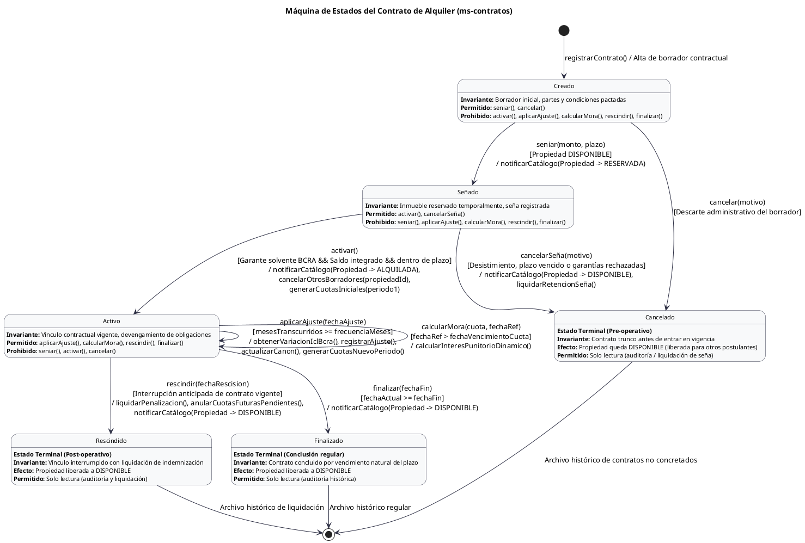

# Dominio del Sistema - Administración de Alquileres Inmobiliarios

> [!TIP] Navegación del Vault TPI
> - [[00 - Mapa de Estudio y Guía Tech Lead]] (Notas atómicas del teórico aplicadas al TPI)
> - [[Diagramas]] (C1, C2, Máquina de Estados y Clases)
> - [[PlanDeTrabajo]] (División de roles y flujo Git)

## Resumen del Dominio

El sistema automatiza la administración integral de alquileres inmobiliarios desacoplando la oferta de inmuebles de la gestión de contratos. Su propósito es administrar las propiedades disponibles, calificar a los involucrados y regir los contratos de locación bajo reglas de negocio estrictas, garantizando actualizaciones monetarias auditables y verificaciones automáticas de solvencia.

En el área de catálogo, se administran las personas y los inmuebles. Las personas unifican a propietarios, inquilinos y garantes vinculados con su identidad digital, registrando sus ingresos y su historial crediticio oficial para determinar si un garante califica económicamente para respaldar un alquiler. Las propiedades registran sus dimensiones, tipología y ubicación geográfica normalizada, lo que permite estimar precios de referencia de mercado y conmutar su estado de disponibilidad a medida que se alquilan o liberan.

En el área de contratos, se formaliza el vínculo entre el inmueble y los participantes fijando montos, fechas, periodicidad de aumentos y recargos por mora. El contrato delega su comportamiento en el patrón State, transitando ordenadamente entre los estados Creado, Señado, Activo, Cancelado, Rescindido y Finalizado. Esta secuencia garantiza que una propiedad señada quede apartada bajo reserva impidiendo alquileres concurrentes, que las reservas no concretadas se cancelen restituyendo la disponibilidad del inmueble a nuevos interesados, y que los contratos extinguidos o rescindidos impidan devengar ajustes por inflación o exigir cánones fuera de término. 

El modelo gestiona las **cuotas de alquiler (`Cuota`) bajo demanda**, desacopladas de pasarelas de pago o recaudación contable externa (fuera del alcance del dominio): al activarse el contrato se genera el lote de cuotas inicial correspondiente al primer período de vigencia según la frecuencia pactada. Posteriormente, cada actualización periódica basada en el Índice de Contratos de Locación (ICL) oficial del BCRA genera el siguiente lote de cuotas ya indexadas con el nuevo canon. Si un contrato es rescindido anticipadamente, las cuotas generadas cuyos vencimientos sean posteriores a la fecha de corte se anulan de inmediato. Por su parte, el recargo punitorio por mora no se almacena como una transacción de cobro, sino que se calcula dinámicamente sobre la cuota ante cualquier consulta o liquidación, contrastando la fecha de referencia contra la fecha de vencimiento y aplicando la tasa diaria convenida.

---

## Servicios de la Arquitectura

La solución está compuesta por tres componentes desplegables y una librería transversal. El punto de acceso único es el **API Gateway**, construido con Spring Cloud Gateway sobre Java 21, encargado de recibir todas las solicitudes entrantes, autenticar los tokens, filtrar los accesos según los permisos del usuario, propagar la identidad y estampar identificadores de correlación en cada petición.

El microservicio **ms-catalogo-inmobiliario** se encarga de dar de alta y consultar inmuebles y personas, estandarizar domicilios y validar el riesgo de los fiadores. En paralelo, el microservicio **ms-contratos** gobierna la creación, activación, rescisión y liquidación de alquileres, comunicándose de forma sincrónica con el catálogo mediante clientes HTTP internos para confirmar que el inmueble esté desocupado y que el garante sea solvente antes de habilitar un contrato. Ambas aplicaciones comparten el artefacto **inmobiliaria-commons**, un paquete Maven que contiene las estructuras de intercambio de datos, los conversores de credenciales y el tratamiento unificado de excepciones de la plataforma.

---

## Bases de Datos

Siguiendo el patrón de base de datos por servicio, la persistencia se encuentra aislada en dos instancias independientes de **PostgreSQL 16** que corren en contenedores aislados. La base de datos del catálogo resguarda las tablas de personas, tipologías e inmuebles con su información catastral y geográfica. Por su parte, la base de datos de contratos almacena exclusivamente los contratos de arrendamiento, el historial de ajustes dinerarios y el registro temporal de índices locativos. Ningún microservicio tiene acceso directo a la base de datos del otro, obligando a que cualquier intercambio de información ocurra mediante APIs REST protegidas.

---

## APIs Externas Utilizadas

El backend se conecta con dos fuentes de datos públicas y oficiales de la República Argentina. Por un lado, utiliza la **API Pública GeoRef AR** del Instituto Geográfico Nacional, a la cual consulta para limpiar y normalizar las direcciones ingresadas por los usuarios y obtener sus coordenadas oficiales de latitud y longitud.

Por otro lado, consume dos extremos de la **API Pública del Banco Central (BCRA)**: el servicio de la Central de Deudores, que permite consultar mediante el CUIT la situación crediticia y de cheques rechazados de los garantes, y el servicio de estadísticas financieras, que suministra el valor diario del Índice de Contratos de Locación (ICL) necesario para recalcular el precio del alquiler en cada período de ajuste.

---

## Roles de Acceso y Seguridad

El control de acceso y la identidad están centralizados en **Keycloak**, servidor OAuth2 y OpenID Connect que autentica a los usuarios y emite tokens JWT firmados criptográficamente. El sistema define tres roles bien diferenciados que condicionan las operaciones habilitadas a través del Gateway y de cada servicio.

El rol **ADMINISTRADOR** posee atribuciones completas de lectura y escritura (`GET`, `POST`, `PUT`, `PATCH`, `DELETE`) para dar de alta propiedades, registrar personas, generar contratos, aplicar ajustes económicos y ejecutar rescisiones sobre cualquier inmueble del sistema.

El rol **PROPIETARIO** cuenta con acceso de solo lectura (`GET`) acotado estrictamente a su patrimonio: **únicamente puede ver sus propiedades y los contratos celebrados sobre esas propiedades**. Puede auditar el estado de sus inmuebles, el canon locativo que está cobrando, el estado del contrato (`Activo`, `Rescindido`, `Finalizado`) y el historial de aumentos aplicados. No tiene acceso a propiedades de otros titulares ni puede realizar modificaciones directas, delegando la gestión operativa en la inmobiliaria.

El rol **INQUILINO** dispone de permisos restringidos de solo lectura (`GET`) con alcance exclusivo sobre su vínculo contractual: **únicamente puede ver sus propios contratos de alquiler**. Puede inspeccionar el canon vigente, las fechas de vigencia y vencimiento de pago mensual, el porcentaje de mora diaria aplicable y el detalle de los ajustes económicos aplicados a su contrato. No tiene acceso al catálogo general de inmuebles desocupados ni a contratos ajenos.

La fiscalización de este aislamiento se ejecuta en dos capas: el **API Gateway** actúa como perímetro bloqueando peticiones mutables a usuarios sin rol de administrador y reenviando el token vía `TokenRelay`, mientras que los microservicios (**OAuth2 Resource Servers**) extraen el identificador de usuario (`sub` / `keycloakUserId`) y aplican cláusulas de filtrado a nivel de repositorio (`findByInquilinoId` y `findByPropietarioId`) para garantizar que ningún cliente acceda a información fuera de su dominio de pertenencia.

---

## Máquina de Estados del Contrato (Patrón State)

El ciclo de vida del contrato de alquiler se modela mediante el patrón de diseño State, distribuyendo el comportamiento del negocio en estados desacoplados que implementan la interfaz común `EstadoContrato`. Cada estado gobierna qué operaciones están permitidas y cuáles prohibidas, garantizando la consistencia legal y financiera del arrendamiento y asegurando la sincronización en tiempo real con el estado de ocupación de las propiedades en el catálogo:

El estado inicial es **Creado**, que representa el borrador contractual preliminar donde se configuran los datos del inmueble, inquilino, canon base y condiciones de ajuste. En este estado el contrato no genera obligaciones exigibles ni permite cobrar alquileres ni aplicar ajustes. Un borrador en estado creado únicamente admite avanzar hacia la reserva formal del inmueble mediante la operación `seniar()` o ser descartado administrativamente mediante `cancelar()`.

La transición clave hacia la reserva es el estado **Señado**, el cual modela el compromiso formal de alquiler previo a la firma definitiva. Para que un contrato pase de creado a señado, el sistema ejecuta como condición de guarda una consulta sincrónica a `ms-catalogo` verificando que la propiedad se encuentre en estado `DISPONIBLE`. Al confirmarse la seña, el contrato pasa a señado y envía una orden inmediata a `ms-catalogo` para mutar la propiedad al estado `RESERVADA`, fijando a su vez una fecha límite de reserva y el monto dinerario entregado en garantía.

La gestión de concurrencia e interesados en pugna queda resuelta de manera determinística por este mecanismo: mientras un inmueble permanezca en estado `RESERVADA`, ninguna otra persona ni contrato borrador puede señar dicha propiedad, ya que cualquier intento de ejecutar `seniar()` será rechazado por la condición de guarda que exige disponibilidad del bien. Desde el estado señado se bifurcan únicamente dos caminos posibles: la concreción efectiva del contrato o su frustración y caída.

El camino de formalización exitosa transiciona el contrato de **Señado a Activo** mediante la operación `activar()`. Para que esta transición sea válida, el sistema corrobora que la fecha actual no haya superado el plazo de vigencia de la seña, que el inquilino haya integrado la totalidad de los fondos iniciales y que el garante supere la evaluación de solvencia crediticia ante la Central de Deudores del BCRA. Al concretarse la activación, el contrato asume plena vigencia legal, notifica a `ms-catalogo` para mutar el inmueble de reservado a `ALQUILADA`, ejecuta una cancelación masiva de cualquier otro borrador en estado `Creado` que hubiera quedado huérfano para esa misma propiedad, y **genera bajo demanda el primer lote de cuotas (`Cuota`)** correspondientes al período inicial acordado (desde la cuota 1 hasta la cantidad de meses estipulada en `frecuenciaAjusteMeses`) fijando su fecha de vencimiento (`diaVencimientoMes`) y el `montoInicial`.

Por el contrario, si la reserva no prospera, el contrato transiciona de **Señado a Cancelado** mediante la operación `cancelarSeña()`. Este evento se dispara ante tres situaciones concretas del negocio: el desistimiento voluntario del inquilino antes de firmar, el vencimiento de la fecha límite de la seña sin haberse completado los requisitos, o el rechazo de la garantía por registrar una situación crediticia desfavorable en el BCRA sin que se presente un reemplazo en término. Como efecto colateral crítico de esta cancelación, el contrato ejecuta la liquidación de la seña (reteniendo o devolviendo el importe conforme a las cláusulas comerciales pactadas) y emite una instrucción sincrónica a `ms-catalogo` para **restituir la propiedad al estado `DISPONIBLE`**. Al quedar disponible nuevamente, la propiedad queda habilitada de inmediato para que cualquier otro postulante interesado pueda iniciar un nuevo borrador o hacer avanzar su contrato previo hacia el estado señado.

El estado operativo central es **Activo**, que rige durante la vigencia legal del arrendamiento. En este estado se admiten tres transacciones fundamentales:
1. **Generación de Nuevas Cuotas por Ajuste ICL**: Al invocar `aplicarAjuste()`, el sistema contrasta los índices ICL provistos por el BCRA o el caché de contingencia, registra la entidad histórica `Ajuste`, actualiza el `montoActual` del contrato y **genera bajo demanda el siguiente bloque de cuotas** para los próximos meses de vigencia hasta el nuevo ajuste, calculadas con el nuevo canon locativo indexado.
2. **Cálculo Dinámico de Mora**: No se gestionan pagos ni transacciones monetarias en el dominio. Al consultar una cuota, el sistema calcula en tiempo real si se encuentra vencida respecto a una fecha de referencia (`fechaConsulta > fechaVencimiento`) y computa la mora aplicando la fórmula directa:
   $$\text{Mora} = \text{MontoBase} \times \left(\frac{\text{porcentajeMoraDiaria}}{100}\right) \times \text{diasAtraso}$$
   $$\text{MontoTotalExigible} = \text{MontoBase} + \text{Mora}$$
3. **Interrupción y Rescisión**: La salida anticipada mediante `rescindir()` liquida la indemnización legal correspondiente según el tiempo restante de vigencia, **anula automáticamente todas las cuotas generadas cuyos vencimientos sean posteriores a la fecha de rescisión** (`EstadoCuota.ANULADA`) para que no figuren como compromisos pendientes, y notifica a `ms-catalogo` para restituir el inmueble a `DISPONIBLE`. Si el contrato concluye por vencimiento regular del plazo pactado, transiciona a `finalizar()`.

Los estados terminales del sistema son tres: **Cancelado**, **Rescindido** y **Finalizado**. El estado `Cancelado` agrupa a aquellos contratos que nunca entraron en vigencia operativa (borradores descartados o señas caídas). El estado `Rescindido` documenta los contratos que se encontraban activos pero sufrieron una ruptura contractual previa al vencimiento del plazo, fijando una multa liquidada y anulando cuotas no devengadas. Por último, el estado `Finalizado` representa la conclusión natural y regular de un contrato que cumplió cabalmente su período temporal. Tanto la cancelación de una seña como la rescisión y la finalización notifican automáticamente al catálogo inmobiliario para liberar el inmueble restituyendo su estado a `DISPONIBLE`. En los tres estados terminales, el contrato congela su comportamiento financiero, prohíbe cualquier reactivación o mutación posterior y permanece exclusivamente como histórico para auditoría y consulta patrimonial.

---

## Funcionalidades y Casos de Uso Significativos (CUS - Criterio DSI)

Siguiendo las pautas metodológicas de la cátedra de Diseño de Sistemas de Información (DSI 3K3), las funcionalidades del sistema se estructuran a partir de los Casos de Uso Arquitectónicamente Significativos que justifican la división de capas, la interacción entre servicios y los patrones de diseño aplicados:

### Pauta 1: ABMC Complejo y Representativo
- **CU-01: Registrar Inmueble con Normalización Geográfica**: Permite al Administrador dar de alta una propiedad ingresando su tipología, dimensiones y dirección cruda. El sistema se comunica con la API de GeoRef AR para validar y normalizar la dirección postal, obtener sus coordenadas exactas (latitud y longitud), evaluar el puntaje de zona y calcular el precio de mercado sugerido por metro cuadrado.
- **CU-02: Registrar y Calificar Solvencia de Persona / Garante**: Permite registrar clientes vinculándolos a su identificador de Keycloak. Al postularse un garante para un contrato, el sistema consulta en tiempo real la API de Central de Deudores del BCRA mediante su CUIT/CUIL, evaluando su situación crediticia histórica y cheques rechazados para determinar mediante reglas de dominio si califica como garante solvente.

### Pauta 2: Transacción Compleja del Negocio (Flujo Principal)
- **CU-03: Crear, Reservar y Formalizar Contrato de Alquiler**: Orquesta la vinculación legal y financiera entre propiedad, propietario, inquilino y garante a lo largo de sus etapas formativas. En primer lugar, se crea el borrador contractual en estado `Creado`. Al concretarse la seña monetaria mediante `seniar()`, el microservicio de contratos ejecuta una llamada sincrónica vía `RestClient` hacia el catálogo inmobiliario para confirmar que el inmueble esté `DISPONIBLE` y conmutarlo a `RESERVADA`, bloqueando intentos de reserva simultáneos por parte de otros interesados. Posteriormente, al postularse la documentación y saldo definitivo, el sistema evalúa la solvencia del garante consultando en tiempo real la Central de Deudores del BCRA; ante una evaluación crediticia favorable y dentro del plazo de vigencia de la seña, ejecuta `activar()`, transiciona el contrato a `Activo`, conmuta la propiedad a `ALQUILADA` en el catálogo, cancela automáticamente cualquier otro borrador que hubiera quedado pendiente sobre el mismo inmueble y **genera bajo demanda el primer lote de cuotas (`Cuota`)** para el período inicial acordado según `frecuenciaAjusteMeses`.

### Pauta 3: Proceso Automático e Indexación Temporal
- **CU-04: Aplicar Ajuste Periódico de Alquiler por ICL**: Proceso por tiempo que detecta los contratos activos cuya frecuencia de aumento fue alcanzada. Obtiene el valor oficial del Índice de Contratos de Locación (ICL) del BCRA (o recurre al caché local de contingencia ante fallos externos), calcula el porcentaje de variación acumulado entre la fecha base y la actual, genera la entidad histórica de `Ajuste`, actualiza el canon locativo vigente del contrato y **genera bajo demanda el lote de cuotas correspondientes al nuevo período indexado**.

### Pauta 4: Transacción Crítica y Máquina de Estados
- **CU-05: Rescindir Contrato o Cancelar Seña de Alquiler**: Gobierna las transiciones críticas de corte del ciclo de vida contractual delegadas en el patrón State:
  - *Cancelación de Seña / Desistimiento*: Si el inquilino desiste, vence el plazo límite de la seña o el garante no supera el análisis crediticio del BCRA, el contrato transiciona de `Señado` a `Cancelado`. La operación ejecuta la liquidación o retención de la seña conforme a las cláusulas comerciales y notifica de inmediato a `ms-catalogo` para revertir la propiedad al estado `DISPONIBLE`, permitiendo que otros postulantes en espera puedan señar el inmueble.
  - *Rescisión Anticipada*: Si un contrato vigente en estado `Activo` se interrumpe antes de término, la operación `rescindir()` calcula la indemnización legal correspondiente a favor del locador según la cantidad de meses transcurridos y el preaviso pactado, **anula automáticamente todas las cuotas generadas con fecha de vencimiento posterior a la fecha de corte** (`EstadoCuota.ANULADA`), congela cualquier devengamiento futuro y notifica a `ms-catalogo` para liberar la propiedad restituyéndola a `DISPONIBLE`.
- **CU-06: Finalizar Contrato por Cumplimiento de Plazo**: Evalúa el vencimiento del plazo temporal convenido, transiciona el contrato desde `Activo` al estado terminal `Finalizado` e instruye la desvinculación y disponibilidad inmediata del inmueble en el catálogo (`DISPONIBLE`).

### Pauta 5: Seguridad y Control de Acceso Perimetral
- **CU-07: Autenticar Usuario y Autorizar Peticiones en Gateway**: Centraliza el ingreso de los clientes autenticando credenciales contra Keycloak. Emite y valida tokens JWT, restringe los métodos mutables (`POST`, `PUT`, `PATCH`, `DELETE`) únicamente a usuarios con rol `ADMINISTRADOR`, e inyecta la cabecera `TokenRelay` y el `X-Correlation-ID` en las peticiones derivadas hacia la red interna de microservicios.

### Pauta 6: Reporte Complejo con Filtro de Seguridad por Usuario
- **CU-08: Consultar Información Patrimonial y Contractual con Filtrado Estricto por Rol**: Permite a usuarios autenticados con perfiles no administrativos acceder exclusivamente a la información asociada a su identidad, garantizando un aislamiento estricto de datos en múltiples niveles arquitectónicos:
  - *Permisos del Rol INQUILINO*: El inquilino tiene potestad de **únicamente visualizar sus propios contratos de alquiler y el cronograma de sus cuotas generadas**. Al invocar los endpoints de consulta en `ms-contratos` (`GET /api/v1/contratos` o `GET /api/v1/contratos/{id}/cuotas`), el microservicio actúa como OAuth2 Resource Server extrayendo el identificador único del usuario (`sub` / `keycloakUserId`) desde el token JWT validado (`@AuthenticationPrincipal Jwt jwt`). El servicio delega la consulta en Spring Data JPA ejecutando `contratoRepository.findByInquilinoId(keycloakUserId)`. A través de esta vista, el inquilino puede inspeccionar el estado actual de su arrendamiento (`Creado`, `Señado`, `Activo`, `Cancelado`, `Rescindido`, `Finalizado`), el canon locativo vigente, el detalle histórico de los ajustes aplicados por ICL, la nómina de cuotas vigentes con sus fechas de vencimiento y el **cálculo dinámico de intereses punitorios por mora** si la consulta se realiza con posterioridad al vencimiento de alguna cuota impaga. El inquilino tiene terminantemente vedado el acceso al catálogo general de propiedades de la inmobiliaria, a inmuebles desocupados y a contratos pertenecientes a otros locatarios. Cualquier intento de acceder por ID a un contrato o cuota ajena devuelve una respuesta `403 Forbidden` o `404 Not Found`.
  - *Permisos del Rol PROPIETARIO*: El propietario tiene potestad de **únicamente visualizar las propiedades de su titularidad y los contratos y cuotas devengadas sobre dichas propiedades**. En `ms-catalogo`, el endpoint de consulta patrimonial resuelve la petición invocando `propiedadRepository.findByPropietarioId(keycloakUserId)`, retornando la nómina de sus inmuebles registrados junto a sus características técnicas, valoración y estado de ocupación (`DISPONIBLE`, `RESERVADA`, `ALQUILADA`). Por su parte, al consultar contratos y cuotas en `ms-contratos`, el servicio aplica la cláusula de seguridad `contratoRepository.findByPropietarioId(keycloakUserId)` (restringiendo a los contratos celebrados sobre sus inmuebles), lo que le permite auditar el rendimiento económico de sus activos: inquilino asociado, canon percibido mensualmente, cuotas emitidas con cálculo dinámico de mora exigible, estado del contrato e historial de incrementos aplicados por variación de ICL. El propietario no puede visualizar inmuebles ni contratos pertenecientes a otros titulares, ni tiene acceso a datos sensibles o evaluaciones crediticias de garantes vinculados a terceras propiedades.
  - *Garantías de Seguridad Arquitectónica*: El control se aplica en dos barreras complementarias. En el perímetro, el **API Gateway** verifica la autenticidad de la firma criptográfica del JWT contra Keycloak y restringe a estos roles a invocar únicamente métodos idempotentes de lectura (`GET`), bloqueando de raíz cualquier intento de mutación (`POST`, `PUT`, `PATCH`, `DELETE`) reservado con exclusividad al `ADMINISTRADOR`. En el interior, los **Microservicios** jamás confían en parámetros de consulta o identificadores provistos en el path o body de la petición para definir la pertenencia del recurso; la identidad se extrae inmutablemente del token JWT verificado, impidiendo cualquier vulnerabilidad de manipulación de identificadores (IDOR / Broken Object Level Authorization). 

---

## Requerimientos No Funcionales (RNF - ISO 25010)

A continuación se detallan los atributos de calidad y restricciones del sistema bajo el marco de la norma ISO/IEC 25010, analizando su impacto formal sobre la arquitectura de software:

| Código     | Categoría ISO 25010                | Descripción del Requerimiento                                                                                                                                                           | ¿Afecta a la Arquitectura? | Justificación Arquitectónica (Criterio Cátedra DSI)                                                                                                                                                 |
| :--------- | :--------------------------------- | :-------------------------------------------------------------------------------------------------------------------------------------------------------------------------------------- | :------------------------: | :-------------------------------------------------------------------------------------------------------------------------------------------------------------------------------------------------- |
| **RNF-01** | **Seguridad**                      | El sistema debe implementar autenticación y autorización basada en roles (RBAC) mediante protocolo OpenID Connect y OAuth2, utilizando tokens JWT firmados criptográficamente.          |           **SÍ**           | Obliga a incorporar un servidor de identidad dedicado (Keycloak), un API Gateway como punto único de validación de acceso y microservicios configurados como OAuth2 Resource Servers.               |
| **RNF-02** | **Interoperabilidad**              | El sistema debe integrarse de forma desacoplada con APIs REST públicas gubernamentales y bancarias de la República Argentina (GeoRef AR y BCRA).                                        |           **SÍ**           | Exige diseñar componentes adaptadores y clientes HTTP dedicados (`Spring RestClient`) con serialización JSON y manejo desacoplado de excepciones externas.                                          |
| **RNF-03** | **Disponibilidad y Confiabilidad** | El cálculo de indexación por ICL debe tolerar caídas temporales, alta latencia o cuotas agotadas en la API pública del BCRA sin interrumpir la operación del negocio.                   |           **SÍ**           | Condiciona el diseño de persistencia incorporando un componente de resiliencia y almacenamiento local (`IndiceIclCache`) que actúa como fallback ante contingencias de red.                         |
| **RNF-04** | **Mantenibilidad**                 | El diseño debe estructurarse en microservicios desacoplados siguiendo el principio *Database per Service*.                                                                              |           **SÍ**           | Impide compartir esquemas de base de datos; exige instancias dedicadas de PostgreSQL 16 para catálogo y contratos, forzando la interacción inter-servicio a través de contratos de interfaz (DTOs). |
| **RNF-05** | **Rendimiento**                    | El API Gateway debe procesar, validar la firma del token y derivar cada petición con una latencia agregada menor a 50 ms para el 95% de las solicitudes concurrentes.                   |           **SÍ**           | Condiciona la selección tecnológica hacia un gateway asincrónico no bloqueante (Spring Cloud Gateway sobre Netty) con verificación local de firmas vía claves públicas cacheadas (JWKS).            |
| **RNF-06** | **Trazabilidad y Observabilidad**  | Todas las peticiones deben registrarse con un identificador de correlación único (`X-Correlation-ID`) que viaje a través de todos los microservicios y se estampe en cada línea de log. |           **SÍ**           | Obliga a construir filtros HTTP interceptores en el Gateway y una librería compartida (`inmobiliaria-commons`) que propague el contexto en el MDC (*Mapped Diagnostic Context*) de SLF4J.           |
| **RNF-07** | **Portabilidad y Despliegue**      | La totalidad de los servicios, bases de datos y el servidor de identidad deben ser empaquetables y desplegables de manera homogénea mediante contenedores Docker.                       |           **SÍ**           | Exige construir imágenes OCI con compilación multi-etapa para cada servicio Java 21 y coordinar su orquestación mediante un manifiesto `docker-compose.yml` con redes virtuales aisladas.           |
| **RNF-08** | **Estandarización de Interfaz**    | Los endpoints de los microservicios deben respetar las convenciones de la arquitectura REST y responder con códigos de estado HTTP semánticos (200, 201, 204, 400, 401, 403, 404, 500). |           **NO**           | Es un estándar de codificación y diseño de controladores/APIs; no introduce servidores adicionales ni altera la estructura de componentes o redes de la arquitectura.                               |
| **RNF-09** | **Tratamiento de Errores**         | El sistema debe devolver respuestas de error uniformes y amigables indicando el motivo y los campos no válidos sin exponer trazas internas de la base de datos o del framework.         |           **NO**           | Se resuelve en el código de aplicación mediante un manejador global de excepciones (`@ControllerAdvice`) y validación de esquemas (`@Valid`), sin alterar la vista arquitectónica.                  |

---

## Documentos Relacionados

* Representación visual en diagramas de clases, contexto C1, contenedores C2 y máquina de estados: [[Diagramas]].
* Distribución de tareas, roles y estrategia del equipo: [[PlanDeTrabajo]].
