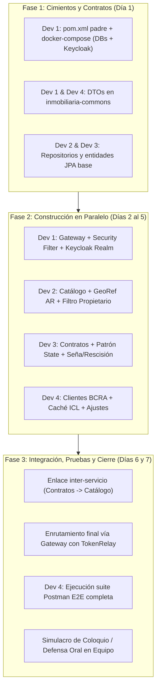
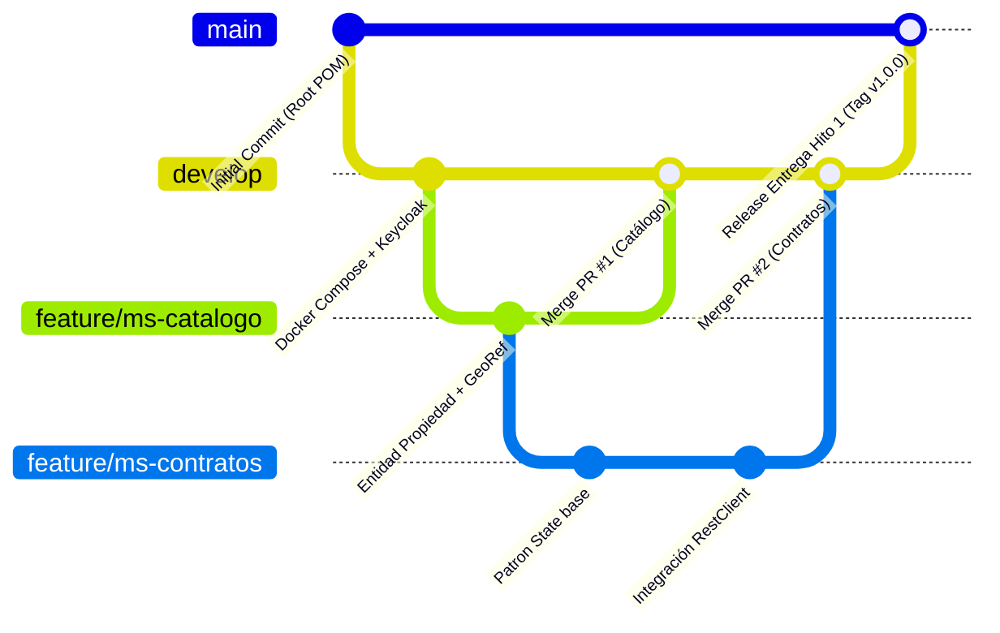

# Plan de Trabajo y Organización del Equipo (4 Integrantes)
### Trabajo Práctico Integrador — Backend de Aplicaciones 2026 (UTN FRC)

---

## 1. Principio Rector del Equipo

> [!IMPORTANT] Regla Anti-Cuello de Botella
> En proyectos universitarios evaluados con defensa oral, **no existe el rol de "DevOps puro" ni de "Coordinador que no programa"**. Los docentes evalúan individualmente a cada integrante sobre el código Java, Spring Boot, transacciones, persistencia y seguridad.
> 
> La distribución se basa en **Ownership Vertical por Componente**: cada integrante es dueño de un módulo o subsistema específico, pero todos programan backend y todos tienen un **"Feature Insignia"** para exponer y defender en el coloquio final.

---

## 2. Matriz de Roles y Responsabilidades

```
┌────────────────────────────────────────────────────────────────────────┐
│ DEV 1: Tech Lead & Gateway (Infraestructura, Seguridad y Commons)      │
├───────────────────────────────────┬────────────────────────────────────┤
│ DEV 2: ms-catalogo-inmobiliario   │ DEV 3: ms-contratos (State Pattern)│
│ (Inmuebles, Personas, GeoRef AR)  │ (Contratos, Seña, Estados, Reglas) │
├───────────────────────────────────┴────────────────────────────────────┤
│ DEV 4: Integración BCRA, Resiliencia ICL y QA/Demo (Postman/E2E)       │
└────────────────────────────────────────────────────────────────────────┘
```

### 👤 Integrante 1: Tech Lead, Infraestructura & API Gateway
*Garantiza que el ecosistema compile, corra en contenedores y filtre la seguridad perimetral.*

* **Módulos bajo su responsabilidad:**
  * Raíz del repositorio: `pom.xml` padre multi-módulo y manifiesto `docker-compose.yml`.
  * `api-gateway`: Servicio Spring Cloud Gateway (Java 21 / Netty).
  * `inmobiliaria-commons`: Estructura inicial del JAR reutilizable.
* **Entregables y Tareas Técnicas:**
  * Configurar `docker-compose.yml` orquestando las 2 instancias de PostgreSQL (`db_catalogo`, `db_contratos`), Keycloak 24+ y redes virtuales Docker.
  * Diseñar y exportar el Realm de Keycloak (`realm-export.json`) con los roles de cátedra (`ADMINISTRADOR`, `PROPIETARIO`, `INQUILINO`), clientes OIDC (`spring-gateway`, `backend-services`) y credenciales de prueba.
  * Programar el **API Gateway**:
    * Filtro de seguridad perimetral: validación de firma criptográfica de tokens JWT contra el endpoint JWKS de Keycloak.
    * Control estricto de métodos HTTP (`POST`, `PUT`, `PATCH`, `DELETE` exclusivos de `ADMINISTRADOR`; `GET` autorizado a `PROPIETARIO` e `INQUILINO`).
    * Inyección de headers transversales: `TokenRelay` hacia servicios internos y filtro `X-Correlation-ID` para observabilidad.
    * Manejo de CORS para clientes web.
  * Inicializar el artefacto `inmobiliaria-commons` con la clase unificada de excepciones `ApiError` y el `@ControllerAdvice` global base.
* **Tema para su Defensa Oral:** Arquitectura de red en contenedores, seguridad perimetral en Spring Cloud Gateway, flujo OAuth2/OIDC con Keycloak y desacoplamiento de infraestructura.

---

### 👤 Integrante 2: Responsable de Catálogo Inmobiliario & GeoRef AR
*Gobierna la oferta inmobiliaria, los actores del sistema y la geolocalización.*

* **Módulos bajo su responsabilidad:**
  * Microservicio `ms-catalogo-inmobiliario`.
  * Base de datos `db_catalogo` (PostgreSQL).
* **Entregables y Tareas Técnicas:**
  * Persistencia JPA: Diseñar y mapear las entidades `Propiedad`, `Persona` (tipos: `PROPIETARIO`, `INQUILINO`, `GARANTE`) y enum `EstadoPropiedad` (`DISPONIBLE`, `RESERVADA`, `ALQUILADA`, `INACTIVA`).
  * Integración con la **API Pública GeoRef AR**:
    * Construir el cliente HTTP desacoplado con Spring `RestClient`.
    * Normalización de direcciones y obtención de coordenadas oficiales (`latitud`, `longitud`).
    * Lógica de negocio para calcular el precio de mercado sugerido por metro cuadrado en base a la ubicación catastral.
  * Controladores y Endpoints REST:
    * `POST /api/propiedades` (Alta con llamada sincrónica a GeoRef).
    * `POST /api/personas` (Alta de personas vinculadas a su `keycloakUserId`).
    * `GET /api/propiedades/propias` (Consulta restringida para rol `PROPIETARIO` mediante filtro de repositorio `findByPropietarioId` usando el claim `sub` del JWT).
    * `PATCH /api/propiedades/{id}/estado` (Endpoint interno protegido para conmutar estado a `RESERVADA`, `ALQUILADA` o `DISPONIBLE`, invocado por contratos).
* **Tema para su Defensa Oral:** Modelo relacional de catálogo, consumo desacoplado de APIs públicas geográficas (GeoRef) y filtro de seguridad en capa de repositorio para Propietarios.

---

### 👤 Integrante 3: Responsable de Contratos & Patrón State (Núcleo de Negocio)
*Gobierna el ciclo de vida legal y financiero de los alquileres y la colaboración inter-servicio.*

* **Módulos bajo su responsabilidad:**
  * Microservicio `ms-contratos`.
  * Base de datos `db_contratos` (PostgreSQL).
* **Entregables y Tareas Técnicas:**
  * Persistencia JPA: Diseñar y mapear las entidades `Contrato`, `Ajuste` y enum `EstadoContratoEnum` (`CREADO`, `SENIADO`, `ACTIVO`, `CANCELADO`, `RESCINDIDO`, `FINALIZADO`).
  * Implementación rigurosa del **Patrón de Diseño State**:
    * Interfaz común `EstadoContrato` y clases concretas de estado (`Creado`, `Senado`, `Activo`, `Cancelado`, `Rescindido`, `Finalizado`).
    * Implementación de guardas e invariantes legales de cada estado.
    * Lógica de seña y reserva: congelamiento de la propiedad y fecha límite.
    * Lógica de rescisión anticipada: cálculo matemático de penalización indemnizatoria (1.5 meses si tiempo < 6 meses, 1 mes si tiempo > 6 meses).
  * Colaboración inter-servicio hacia `ms-catalogo`:
    * Implementar cliente `RestClient` interno para consultar disponibilidad del bien y ordenar la conmutación a `RESERVADA`, `ALQUILADA` o `DISPONIBLE`.
  * Controladores y Endpoints REST:
    * `POST /api/contratos` (Alta de borrador en estado `Creado`).
    * `POST /api/contratos/{id}/seniar` (Transición a `Señado`).
    * `POST /api/contratos/{id}/activar` (Transición a `Activo` con verificación de garantías y cancelación de borradores competidores).
    * `POST /api/contratos/{id}/cancelar` (Cancelación de seña y liberación del bien a `DISPONIBLE`).
    * `POST /api/contratos/{id}/rescindir` y `/finalizar`.
    * `GET /api/contratos/mis-contratos` (Filtro estricto por `sub` para `INQUILINO`).
    * `GET /api/contratos/propietario` (Filtro estricto por `sub` para `PROPIETARIO`).
* **Tema para su Defensa Oral:** Implementación del patrón State en JPA, transaccionalidad inter-servicio y reglas de negocio del ciclo de vida contractual.

---

### 👤 Integrante 4: Responsable de Integraciones BCRA, Resiliencia ICL y QA/Demo
*Garantiza la inteligencia financiera, la tolerancia a fallos ante el Banco Central y la defensa del proyecto.*

* **Módulos bajo su responsabilidad:**
  * Clientes de integración externa con BCRA (compartidos/distribuidos entre Catálogo y Contratos).
  * Módulo de resiliencia y caché local de índices (`IndiceIclCache`).
  * Suite de pruebas funcionales y automatización de la Demo (Postman / Bruno).
* **Entregables y Tareas Técnicas:**
  * Integración con **API Pública BCRA — Central de Deudores**:
    * Cliente `RestClient` para consultar situación crediticia y cheques rechazados por CUIT de garantes.
    * Lógica de evaluación de solvencia (`situacionCrediticia <= 2`, `chequesRechazados == 0`, ingresos suficientes).
  * Integración con **API Pública BCRA — Principales Variables (ICL)**:
    * Cliente `RestClient` para obtener el valor oficial diario del Índice de Contratos de Locación.
    * Lógica matemática de ajuste: $\text{Canon Nuevo} = \text{Canon Anterior} \times (\text{ICL}_{\text{hasta}} / \text{ICL}_{\text{desde}})$.
    * **Mecanismo de Resiliencia y Contingencia**: Persistencia en tabla `IndiceIclCache` y fallback automático ante indisponibilidad, cuotas agotadas o caídas del servicio del BCRA.
  * Proceso masivo de indexación temporal: endpoint o scheduler para detectar contratos a aumentar y asentar los registros de `Ajuste`.
  * **Dueño de la Calidad y la Demo (QA Lead)**:
    * Colección completa y documentada en **Postman o Bruno** con variables de entorno (`baseUrl`, `tokenAdmin`, `tokenInquilino`, `tokenPropietario`), scripts de tests automáticos (`pm.test`) y flujo continuo de punta a punta.
    * Verificación de especificaciones OpenAPI / Swagger UI en cada microservicio.
* **Tema para su Defensa Oral:** Estrategia de resiliencia ante contingencias de APIs externas (BCRA), cálculo del índice ICL y orquestación de la demostración en vivo.

---

## 3. Plan de Ejecución en 3 Fases



---

## 4. Flujo de Trabajo en GitHub (Estrategia Anti-Conflictos)

Para que 4 desarrolladores trabajen en simultáneo sobre el mismo repositorio sin pisarse el código ni sufrir el "infierno de merge conflicts", el equipo implementará un flujo de trabajo disciplinado pero ágil basado en **GitHub Flow con rama de integración**.

---

### 4.1. Estructura y Jerarquía de Ramas



* **`main` (Rama de Entrega / Producción)**:
  * Es intocable. **Terminantemente prohibido hacer `git push` directo.**
  * Solo recibe código probado y validado proveniente de `develop` mediante Pull Request al cerrar un hito de entrega.
  * Código en `main` debe compilar al 100%, pasar todos los tests y levantar sin errores con `docker compose up --build`.
* **`develop` (Rama de Integración Continua)**:
  * Rama base sobre la cual convergen los desarrollos de los 4 integrantes.
  * Cada nuevo feature se desprende de `develop` y se fusiona a `develop` mediante PR.
* **`feature/<modulo>-<descripcion>` (Ramas de Trabajo Personal)**:
  * Nomenclatura obligatoria:
    * `feature/gateway-security` (Dev 1)
    * `feature/catalogo-georef` (Dev 2)
    * `feature/contratos-state` (Dev 3)
    * `feature/bcra-resiliencia` (Dev 4)
  * Son ramas efímeras: se crean, se desarrolla el feature puntual, se abre PR a `develop` y se eliminan al fusionarse.

---

### 4.2. Aislamiento Físico por Módulos (La Barrera Arquitectónica)

La mejor defensa contra los conflictos de Git no es el software, es la **estructura del proyecto**. Al ser un proyecto multi-módulo de Maven, cada integrante tiene asignada una frontera de archivos:

| Integrante | Módulo / Carpeta Física Exclusiva | Regla de Acceso |
| :--- | :--- | :--- |
| **Dev 1** | `/api-gateway` y `/docker-compose.yml` | Solo Dev 1 modifica estos archivos. |
| **Dev 2** | `/ms-catalogo-inmobiliario` | Solo Dev 2 modifica estos archivos. |
| **Dev 3** | `/ms-contratos` | Solo Dev 3 modifica estos archivos. |
| **Dev 4** | `/ms-contratos/client/bcra` y `/ms-catalogo/client/bcra` | Agrega sus clientes desacoplados en sub-paquetes `client`. |
| **TODOS** | `/inmobiliaria-commons` | **MÓDULO COMPARTIDO.** Aplica el protocolo estricto "Commons First". |

> [!TIP] Resultado Práctico
> Si Dev 2 jamás abre ni edita un archivo dentro de `ms-contratos/`, y Dev 3 jamás toca `ms-catalogo-inmobiliario/`, **es matemáticamente imposible que Git arroje conflictos de código en esos servicios**.

---

### 4.3. Protocolo "Commons First" (Cómo Modificar Código Compartido)

El único punto de posible conflicto es el módulo compartido `inmobiliaria-commons` (donde viven los DTOs como `PropiedadDTO` o `ValidacionGaranteDTO`). Para evitar desfasajes, se aplica el siguiente protocolo:

1. **Aviso Previo**: Si Dev 3 (Contratos) necesita que `PropiedadDTO` tenga un nuevo campo `estadoPropiedad`:
   * Avisa al grupo (WhatsApp/Discord): *"Chicos, voy a agregar el campo `estadoPropiedad` a `PropiedadDTO` en commons"*.
2. **PR Rápido e Independiente de Commons**:
   * Dev 3 crea una rama rápida: `git checkout -b feature/commons-dto-propiedad`.
   * Agrega el atributo en la clase DTO en `inmobiliaria-commons`.
   * Verifica compilación local: `mvn clean install -pl inmobiliaria-commons`.
   * Abre PR directo a `develop`: *"feat(commons): agregar estadoPropiedad a PropiedadDTO"*.
3. **Aprobación Express y Rebase General**:
   * Dev 1 (o Dev 2) aprueba el PR en GitHub y se mergea a `develop`.
   * Los 4 integrantes ejecutan en sus ramas locales:
     ```bash
     git checkout develop
     git pull origin develop
     git checkout feature/mi-rama
     git merge develop
     mvn clean install
     ```
   * Ahora todos tienen la última versión del DTO disponible sin bloquearse.

---

### 4.4. El Ritual Diario de Sincronización (5 Minutos al Iniciar el Día)

Para evitar que tu rama quede desactualizada con respecto al trabajo de tus compañeros, cada desarrollador debe ejecutar esta rutina **antes de escribir la primera línea de código del día**:

```bash
# 1. Pararse en develop y traer lo nuevo del servidor
git checkout develop
git pull origin develop

# 2. Volver a tu rama de trabajo
git checkout feature/mi-rama

# 3. Traer los cambios de develop hacia tu rama de trabajo
git merge develop

# 4. Asegurar que todo el backend compila con los cambios de los demás
mvn clean compile
```

Si haces esto todos los días, nunca tendrás un conflicto de más de 2 líneas de código.

---

### 4.5. Protocolo de Pull Request (Definition of Done)

Para que un integrante pueda fusionar su rama a `develop`, debe cumplir estrictamente con el siguiente checklist:

#### Checklist Pre-PR (Local en tu máquina):
- [ ] Compilación exitosa desde la raíz del proyecto: `mvn clean install` sin errores en ninguno de los módulos.
- [ ] Los tests unitarios y de integración locales pasan (`BUILD SUCCESS`).
- [ ] No se suben archivos basura (`target/`, `.idea/`, `.vscode/`, `.env`, logs). El `.gitignore` debe estar limpio.
- [ ] Si se modificó la configuración de Docker, `docker compose up --build` levanta el servicio sin crashear.

#### En GitHub:
1. **Crear el Pull Request**: De `feature/mi-rama` hacia `develop`.
2. **Descripción Clara**: Breve resumen de:
   * ¿Qué se hizo? (ej: *"Se implementó el cliente RestClient para GeoRef y cálculo de precio sugerido"*).
   * ¿Qué endpoints nuevos están disponibles? (ej: `POST /api/propiedades`).
   * ¿Cómo probarlo en Postman?
3. **Revisión Obligatoria**: Se requiere al menos **1 aprobación (Review Approve)** de otro integrante antes de poder mergear.
4. **Estrategia de Merge**: Seleccionar siempre **"Squash and Merge"** en GitHub. Esto colapsa todos los commits de prueba (`"fix"`, `"prueba"`, `"ahora si"`) en un único commit limpio en `develop`, manteniendo el historial impecable.

---

### 4.6. Integración Continua Automatizada (GitHub Actions CI)

Para blindar el repositorio y que nadie pueda romper `develop` aunque se equivoque, se implementará un workflow básico y gratuito de GitHub Actions (`.github/workflows/ci.yml`):

* **Cuándo se ejecuta:** En cada Pull Request que apunte a `develop` o `main`.
* **Qué hace automáticamente:**
  1. Levanta un runner con Ubuntu y Java 21 Temurin.
  2. Ejecuta `mvn clean verify`.
  3. Si algún microservicio no compila o falla un test, **marca el PR con una cruz roja y bloquea el botón de Merge**.
* **Beneficio:** Imposibilita que código roto llegue a `develop`.

---

### 4.7. Guía de Emergencia ante Conflictos de Git

Si al hacer `git merge develop` la consola arroja:
`CONFLICT (content): Merge conflict in ...`

**Paso a paso para resolverlo con calma:**
1. **No entres en pánico ni uses `git push --force`.**
2. Abrí el archivo en conflicto en tu IDE (VS Code o IntelliJ marcan visualmente las secciones en verde y azul: *Current Change* vs *Incoming Change*).
3. Si el conflicto es en un archivo tuyo: elegí la versión correcta que integre ambos cambios.
4. Si el conflicto es en un archivo ajeno o en `pom.xml`: **llamá por llamada al dueño de ese archivo** y resuélvanlo juntos en 2 minutos.
5. Guardá el archivo, ejecutá:
   ```bash
   git add <archivo-resuelto>
   git commit -m "chore: resolver conflicto de merge con develop"
   git push origin feature/mi-rama
   ```

---

## 5. Documentos Relacionados

* Especificación del Negocio y Casos de Uso: [[Dominio]]
* Diagramas C4 y Máquina de Estados: [[Diagramas]]
