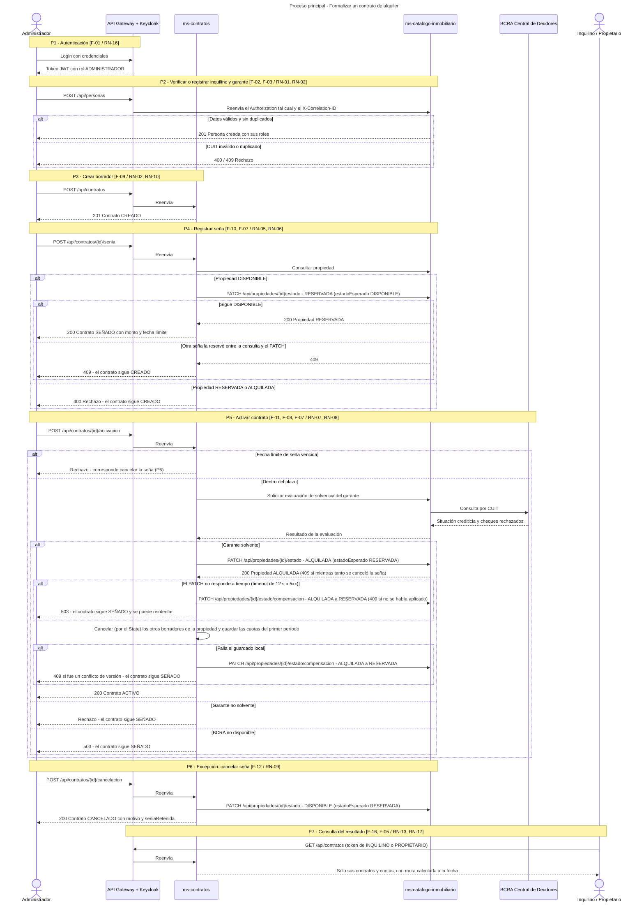

# Proceso Principal — Formalizar un Contrato de Alquiler

Diagrama de secuencia del proceso de negocio principal del sistema: desde que la inmobiliaria inicia la operación hasta que el contrato queda `ACTIVO` y las partes pueden consultarlo. Cada nota del diagrama corresponde a un paso del proceso (P1 a P7) e indica las funcionalidades (F-xx) y reglas de negocio (RN-xx) que intervienen, según el formulario de alcance del TPI.

Los bloques `alt` representan las decisiones y excepciones del proceso: propiedad no disponible, seña vencida, garante no solvente y BCRA no disponible. `ms-contratos` nunca accede a los datos del catálogo en forma directa: siempre los consulta o modifica a través de su API REST (*Database per Service*).

El ciclo de vida posterior del contrato (ajustes por ICL, rescisión y finalización) se detalla en la máquina de estados de [Diagramas](./Diagramas.md).

## Saga con el catálogo

Cada cambio de estado de la propiedad que pide `ms-contratos` lleva el estado en el que la espera (`estadoEsperado`): si otro proceso la cambió en el medio, el catálogo responde 409 y no la toca. Así, por ejemplo, una activación y una cancelación simultáneas del mismo contrato no pueden dejar la propiedad libre con el contrato activo.

Si el PATCH salió bien pero falla el guardado local del contrato, `ms-contratos` deshace el cambio con `PATCH /api/propiedades/{id}/estado/compensacion`, que solo acepta volver atrás una transición válida:

| Operación | Paso de la propiedad | Compensación |
|---|---|---|
| Señar | DISPONIBLE → RESERVADA | RESERVADA → DISPONIBLE |
| Activar | RESERVADA → ALQUILADA | ALQUILADA → RESERVADA |
| Cancelar una seña | RESERVADA → DISPONIBLE | DISPONIBLE → RESERVADA (con inquilino y garante) |
| Rescindir / finalizar | ALQUILADA → DISPONIBLE | DISPONIBLE → ALQUILADA (con inquilino y garante) |

Después de compensar se devuelve el error original: un conflicto de versión del contrato sale como 409. Si la compensación también falla, se registra en ERROR con el contrato, la propiedad y el `X-Correlation-ID` para corregirla a mano.

Si el PATCH de ida termina **sin una respuesta clara** (timeout de 12 s, 5xx o la conexión cortada), `ms-contratos` no sabe si el catálogo aplicó el cambio: intenta igual la compensación y después devuelve el error original (503). Si el cambio no se había aplicado, la compensación responde 409 sin tocar nada y se registra en INFO como "no hacía falta"; si se había aplicado, la propiedad vuelve a su estado. Así la propiedad no queda trabada (antes, cada reintento daba 409) y el contrato se puede reintentar. Ante un rechazo claro del catálogo (400/422, 404, 409, 401/403 u otro 4xx) no se compensa, porque no cambió nada.

Ninguna de estas operaciones mantiene una transacción abierta mientras espera al catálogo: el contrato se lee y el State valida la transición en una transacción corta de lectura, las llamadas HTTP (la evaluación del garante pasa por el BCRA y puede tardar hasta 12 s) van fuera de toda transacción, y el resultado se guarda en una escritura corta. Si mientras tanto otra operación modificó el contrato, el `@Version` rechaza la escritura con 409 y se compensa la propiedad.

## Rescisión y finalización

- **Rescindir** (RN-14): la `fechaRescision` tiene que estar entre la `fechaInicio` del contrato y hoy (como mucho la `fechaFin`). No puede ser futura, porque la rescisión libera la propiedad en el acto; una rescisión acordada para más adelante se registra ese día. Se anulan las cuotas pendientes que vencen después de la fecha de rescisión. La penalización es de 1,5 cánones si la `fechaRescision` es anterior a `fechaInicio + 6 meses` (con la misma suma de meses del calendario: inicio el 31/08/2026 → 28/02/2027) y de 1 canon si no; el canon es el vigente a la fecha de rescisión, o sea el del tramo que la contiene (una rescisión retroactiva al 15/09 de un contrato ajustado a 625.000 desde el 01/10 se calcula sobre 500.000). Si a la fecha de rescisión ya correspondía un ajuste que no se aplicó (su hito es igual o anterior), se rechaza con 400 "Antes de rescindir … aplicá el ajuste N° k (ventana H_(k-1) → H_k)": las cuotas de ese tramo están devengadas y todavía no se emitieron.
- **Finalizar** (RN-15): solo desde la `fechaFin`. Las cuotas cuyo período empezó antes de la fecha de fin están devengadas y no se anulan aunque venzan después (contrato del 01/12 al 20/12 con vencimiento el día 25: la cuota del 25/12 se cobra). Solo se anulan, como defensa, las cuotas pendientes cuyo período empieza en o después de la fecha de fin, que con la generación por tramos no existen. Si queda algún ajuste sin aplicar (su hito es anterior a la fecha de fin), se rechaza con 400 "Antes de finalizar … aplicá el ajuste N° k": sin él, las cuotas de su tramo nunca se emitirían.

## Cuotas emitidas tarde

Cada cuota guarda su `fechaEmision` (la fecha en que se generó) y la mora corre desde `max(fechaVencimiento, fechaEmision)`. Una cuota que se emite después de su vencimiento (contrato activado con inicio en el pasado, o ajuste demorado por un IPC todavía no publicado o el BCRA caído) no nace con mora retroactiva: el día de emisión tiene mora 0 y crece desde ahí.

## Ajustes por índice

El ajuste número k corresponde en el hito `H_k = fechaInicio + k × frecuencia` meses, si ese hito es anterior a la fecha de fin y ya se aplicaron los anteriores. La ventana del índice es de `H_(k-1)` a `H_k`, sin importar el día en que se ejecute el ajuste, y cada ajuste emite las cuotas de su período (las cuotas `k·f` a `(k+1)·f − 1`). El período se valida antes de consultar el índice; las fechas del pedido son opcionales y, si vienen, tienen que coincidir. El índice se consulta fuera de la transacción. Las cuotas que emite un ajuste aplicado tarde llevan como fecha de emisión el día en que se aplicó (ver "Cuotas emitidas tarde").

El proceso programado (y `POST /api/contratos/ajustes-periodicos`) pone al día cada contrato activo aplicando en orden todos sus ajustes pendientes, cada uno en su propia transacción, y devuelve `{contratosRevisados, ajustesAplicados, pendientes: [{contratoId, motivo}]}`. Un contrato cuyo índice no está disponible queda pendiente para la próxima corrida sin frenar a los demás.

