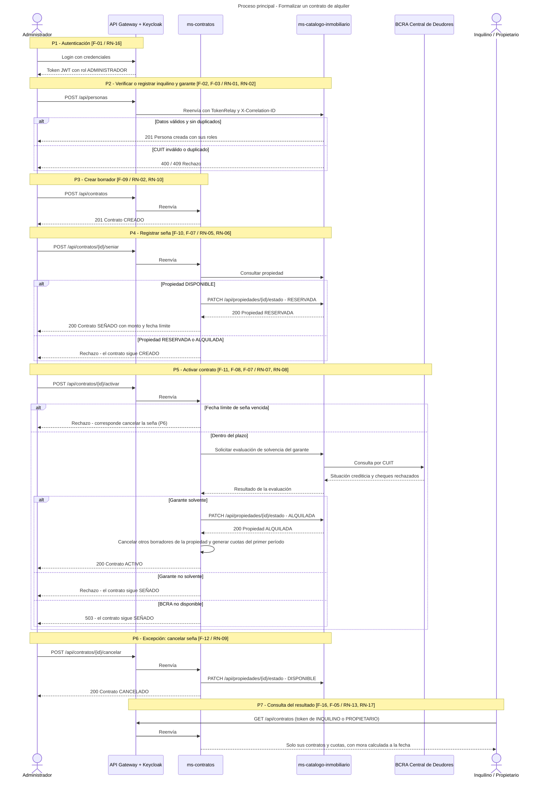

# Proceso Principal — Formalizar un Contrato de Alquiler

Diagrama de secuencia del proceso de negocio principal del sistema: desde que la inmobiliaria inicia la operación hasta que el contrato queda `ACTIVO` y las partes pueden consultarlo. Cada nota del diagrama corresponde a un paso del proceso (P1 a P7) e indica las funcionalidades (F-xx) y reglas de negocio (RN-xx) que intervienen, según el formulario de alcance del TPI.

Los bloques `alt` representan las decisiones y excepciones del proceso: propiedad no disponible, seña vencida, garante no solvente y BCRA no disponible. `ms-contratos` nunca accede a los datos del catálogo en forma directa: siempre los consulta o modifica a través de su API REST (*Database per Service*).

El ciclo de vida posterior del contrato (ajustes por ICL, rescisión y finalización) se detalla en la máquina de estados de [Diagramas](./Diagramas.md).
